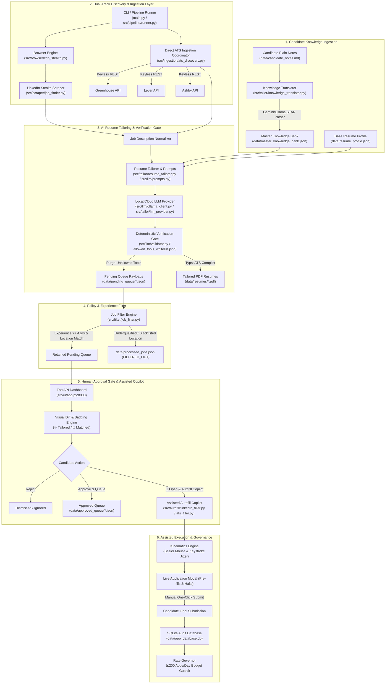

# System Architecture & Technical Specification: LinkedIn Job Search & Application Automator

> **Document Type:** AI-Readable & Human-Reviewable System Architecture Document  
> **Repository:** `manjunathk833/linkedin-automator`  
> **Status:** Production-Ready / Active Development (Branch: `develop`)  
> **Target Audience:** Technical Auditors, Senior SDET Architects, AI Reviewers, Open-Source Contributors  
> 
> 📚 **Complete Documentation Suite in [`docs/`](docs/README.md):**
> * [**01_USER_GUIDE.md**](docs/01_USER_GUIDE.md): Plain-English walkthrough, daily workflows, and customization cheat sheet.
> * [**02_CONCEPTUAL_ARCHITECTURE.md**](docs/02_CONCEPTUAL_ARCHITECTURE.md): Zero-cost economics, dual-track ingestion, and anti-detection threat model.
> * [**03_TECHNICAL_SPECIFICATION.md**](docs/03_TECHNICAL_SPECIFICATION.md): Exhaustive breakdown of Modules 1–10 and data schemas.
> * [**04_USAGE_AND_OPERATIONS.md**](docs/04_USAGE_AND_OPERATIONS.md): CLI subcommands and troubleshooting playbooks.
> * [**05_VERIFICATION_AND_TESTING.md**](docs/05_VERIFICATION_AND_TESTING.md): Catalog of all 32 verification test scripts.

---

## 1. Executive Summary & North Star Vision

The **LinkedIn Job Search & Application Automator** is an autonomous, 100% zero-third-party-cost system designed specifically for **Senior SDET / Lead QA Automation Engineers** (5+ years experience threshold, Bengaluru / India Remote focus).

### Core Pillars
1. **Zero Third-Party Cost Guarantee:** Operates strictly on Google Gemini Free Tier APIs with automatic fallback to local offline LLMs via Ollama (`qwen2.5:7b`). No paid proxies, captcha solvers, or proprietary LLM subscriptions.
2. **Deterministic Anti-Fabrication Grounding:** AI tailoring is strictly constrained to the candidate's authentic profile and master knowledge vault. A deterministic post-generation validation gate filters out hallucinated tech tools before resumes reach employers.
3. **Multi-Channel 10X Discovery:** Scrapes beyond standard keyword searches across 4 distinct discovery vectors: Active Search, Recommended Feed, Recruiter Postings, and Similar Jobs.
4. **Human-in-the-Loop (HITL) Integrity:** Zero autonomous blind applications. Applications must pass through a local FastAPI Web Dashboard (`http://localhost:8000`) for human inspection, resume diff review, and approval.
5. **Headful Visual Automation & Safe Session Persistence:** Employs Chrome DevTools Protocol (CDP) and persistent browser profiles with anti-bot stealth parameters to prevent session invalidation or account suspension.

---

## 2. High-Level System Architecture



---

## 3. Module-by-Module Technical Implementation

### Module 1: CLI Entrypoint & Pipeline Orchestration
* **Files:** [`main.py`](file:///Users/yeshwinmanjunath/development/linkedinjobsearchautomation/main.py), [`src/pipeline/runner.py`](file:///Users/yeshwinmanjunath/development/linkedinjobsearchautomation/src/pipeline/runner.py)
* **Design Pattern:** `argparse.add_subparsers()` decoupled into a `JobSearchPipelineRunner` controller.
* **Capabilities:**
  * `python main.py run` (`pipeline`) `[--source all|linkedin|ats]` `[--headless]`: One-shot automated workflow (`sync` $\rightarrow$ unified `search` across all sources $\rightarrow$ `filter` $\rightarrow$ `dashboard`).
  * `python main.py search [--source all|linkedin|ats] [--headless]`: Unified multi-source job discovery across Direct ATS boards (Greenhouse, Lever, Ashby) and LinkedIn multi-channel stealth search with AI resume tailoring and cross-source deduplication.
  * `python main.py sync`: Syncs natural language markdown notes to the master knowledge bank.
  * `python main.py filter`: Evaluates experience threshold on raw scraped jobs across all sources.
  * `python main.py dashboard`: Launches FastAPI web dashboard.
  * `python main.py apply [--no-dry-run]`: Executes Easy Apply automation on approved jobs.
  * `python main.py login`: Launches persistent headful Chrome for manual session authentication.
  * `python main.py lint`: Runs Ruff linter and auto-fix formatter.
  * `python main.py autofill`: Inspects ATS autofill diagnostic logs and learning vault lessons.
  * `python main.py test [--tier core|autofill|all] [--live]`: Standardized multi-tier regression test runner executing Tier 1 Core (48 offline tests in <45s), Tier 2 Autofill (Playwright simulations), or Tier 3 Live portal tests.

---

### Module 2: Browser Context, Anti-Detection & Kinematics Engine
* **Files:** [`src/browser/cdp_stealth.py`](file:///Users/yeshwinmanjunath/development/linkedinjobsearchautomation/src/browser/cdp_stealth.py), [`src/browser/kinematics.py`](file:///Users/yeshwinmanjunath/development/linkedinjobsearchautomation/src/browser/kinematics.py), [`src/browser/cdp_connector.py`](file:///Users/yeshwinmanjunath/development/linkedinjobsearchautomation/src/browser/cdp_connector.py)
* **Architecture:** Persistent Chrome profile with runtime CDP isolation, anti-fingerprinting JS evasions, and humanized input kinematics.
* **Stealth & Resilience Parameters:**
  * **CDP Isolation:** Removes `navigator.webdriver` artifact, injects authentic `window.chrome` runtime/loadTimes mocks, and emulates macOS Chrome plugins and English language arrays.
  * **Kinematics Engine:** Formulates non-linear mouse paths using cubic Bézier curves:
    $$B(t) = (1-t)^3 P_0 + 3(1-t)^2 t P_1 + 3(1-t) t^2 P_2 + t^3 P_3, \quad t \in [0, 1]$$
    with smoothstep easing and micro-tremor jitter.
  * **Log-Normal Keystroke Intervals:** Keystroke timings modeled via log-normal distribution ($40–240$ ms per character) with randomized pauses after punctuation.
  * **Dynamic Driver Selection:** Supports drop-in of `rebrowser-playwright` with graceful fallback to persistent system Chrome.

---

### Module 3: Multi-Channel Job Scraper & Description Parser
* **Files:** [`src/scraper/job_finder.py`](file:///Users/yeshwinmanjunath/development/linkedinjobsearchautomation/src/scraper/job_finder.py)
* **Scraping Channels:**
  1. `Search`: Direct keyword search with filters (e.g. `Senior SDET`, `Remote`, `Past 24 Hours`).
  2. `Recommended Feed`: Navigates to `linkedin.com/jobs/` and iterates dynamically loaded recommendation modules.
  3. `Recruiter Posts`: Queries content posts mentioning hiring tags (`#hiring #sdet`).
  4. `Similar Jobs`: Extracts related job cards from the detail view of high-relevance listings.
* **Layout Resilience & Noise Filtering:**
  * Interactive title clicking (`.job-card-list__title`) to trigger detail panel rendering without page reload.
  * Auto-expands "See more" buttons (`button.jobs-description__footer-button`).
  * Regex-based cleaner (`clean_job_description`) strips boilerplate UI noise (e.g., share icons, promo banners, report buttons).
  * Deduplication engine using MD5 composite hashes (`company:title:location`).
  * **External ATS & Discovery Velocity Parameters:**
    * `easy_apply_only: false` eliminates the forced `f_AL=true` restriction, allowing the system to discover the 80%+ enterprise tech opportunities linking out to external ATS platforms.
    * `distance: 25` enforces an explicit 25-mile (~40 km) radius for metro areas like Bengaluru.
    * `time_posted: "past_week"` (`f_TPR=r604800`) enforces a high-velocity 7-day window (preventing ingestion of stale 30-day postings), configurable down to 24h (`past_24h` / `f_TPR=r86400`).
    * **Upfront Application Type Tagging:** Inspects apply button text and aria labels to classify jobs upfront as `EASY_APPLY` vs `LINKEDIN_EXTERNAL` and stores external redirect URLs when available.

---

### Module 4: Grounded AI Resume Tailoring & Anti-Fabrication Gate
* **Files:** [`src/tailor/resume_tailorer.py`](file:///Users/yeshwinmanjunath/development/linkedinjobsearchautomation/src/tailor/resume_tailorer.py), [`src/tailor/llm_provider.py`](file:///Users/yeshwinmanjunath/development/linkedinjobsearchautomation/src/tailor/llm_provider.py), [`src/tailor/fabrication_detector.py`](file:///Users/yeshwinmanjunath/development/linkedinjobsearchautomation/src/tailor/fabrication_detector.py), [`src/tailor/knowledge_translator.py`](file:///Users/yeshwinmanjunath/development/linkedinjobsearchautomation/src/tailor/knowledge_translator.py)
* **LLM Architecture:**
  * `HybridLLMProvider`: Primary provider Google Gemini Free Tier (`models/gemini-flash-lite-latest`, `temperature=0.0`) with 4.0s minimum interval rate pacer, 60s quota cooldown circuit-breaker, and multi-model fallback chain (`models/gemini-flash-latest`, `models/gemini-3.5-flash`, `gemini-3.8-flash`); automatic fallback to local Ollama (`qwen2.5:7b`).
  * Request Telemetry Logging: Every API invocation records timestamp, model, duration (ms), status (SUCCESS/FAILED), and error details to `data/logs/llm_requests.log`.
  * Pydantic schema validation (`TailoredBulletsResponse`, `ParsedKnowledgeResponse`, `ScreeningAnswerResponse`).
* **Anti-Fabrication Defense-in-Depth:**
  * **Level 1 (Prompt Grounding):** Strict prompt instructions and negative few-shot examples forbidding hallucination of tools outside candidate history.
  * **Level 2 (Deterministic Code Gate):** `FabricationDetector` builds an `allowed_tools` set from `resume_profile.json` and `master_knowledge_bank.json`. Any AI bullet containing unallowed tools (e.g., Cypress, Golang, Terraform) is **stripped and discarded** prior to queueing.
* **Knowledge Bank Translation Layer:**
  * Candidates write plain text notes in `data/candidate_notes.md`.
  * `KnowledgeBankTranslator` parses bullet points, chunks them into batches of 5, translates them to STAR format, deduplicates via MD5 hashing, and atomically writes to `data/master_knowledge_bank.json` via `os.replace()`.

---

### Module 5: Experience & Policy Filter Engine
* **Files:** [`src/filter/job_filter.py`](file:///Users/yeshwinmanjunath/development/linkedinjobsearchautomation/src/filter/job_filter.py)
* **Heuristics:**
  * Regex pattern matching for experience thresholds (e.g., `(\d+)\+?\s*years?`).
  * Filters out underqualified jobs (<4 years required) or overqualified executive roles (>12 years).
  * Strict location rules: Retains Bengaluru (Onsite/Hybrid/Remote) or India (Remote). Discards non-Bengaluru onsite roles (e.g., Pune, Hyderabad onsite).
  * Atomic synchronization with `data/processed_jobs.json`.

---

### Module 6: Human-in-the-Loop Approval Gate Dashboard
* **Files:** [`src/ui/app.py`](file:///Users/yeshwinmanjunath/development/linkedinjobsearchautomation/src/ui/app.py), [`src/ui/static/app.js`](file:///Users/yeshwinmanjunath/development/linkedinjobsearchautomation/src/ui/static/app.js), [`src/ui/static/index.html`](file:///Users/yeshwinmanjunath/development/linkedinjobsearchautomation/src/ui/static/index.html)
* **Features:**
  * FastAPI server serving a dark-mode, glassmorphism interface at `http://localhost:8000`.
  * **Resume Diff Engine:** `compute_resume_diff` compares tailored bullets against base resume achievements, highlighting differences with glowing `✨ Tailored` and `🎯 Matched: <skills>` tags.
  * Interactive Actions: Approve (moves to `data/approved_queue/`), Reject, and Edit Resume.
  * Analytics panel tracking discovery counts, filter rates, and application status.

---

### Module 7: Easy Apply Automation Engine
* **Files:** [`src/automation/easy_apply.py`](file:///Users/yeshwinmanjunath/development/linkedinjobsearchautomation/src/automation/easy_apply.py)
* **Automation Workflow:**
  1. Opens job listing in persistent browser context.
  2. Detects and clicks Easy Apply triggers (`.jobs-apply-button`, `button[data-job-id]`).
  3. Iterates modal form steps: contact info, phone, resume upload, screening questions.
  4. Resolves screening questions using `HybridLLMProvider.answer_screening_question()` grounded in candidate profile.
  5. **Safety Gate:** Default `dry_run=True` fills forms, captures step screenshots, and closes the modal without submitting. Real submission requires explicit `--no-dry-run`.
  6. Logs outcome to `data/application_history.json`.

---

### Module 7: Multi-Source Keyless ATS Ingestion Engine
* **Files:** [`src/ingestion/greenhouse.py`](file:///Users/yeshwinmanjunath/development/linkedinjobsearchautomation/src/ingestion/greenhouse.py), [`src/ingestion/lever.py`](file:///Users/yeshwinmanjunath/development/linkedinjobsearchautomation/src/ingestion/lever.py), [`src/ingestion/ashby.py`](file:///Users/yeshwinmanjunath/development/linkedinjobsearchautomation/src/ingestion/ashby.py), [`src/ingestion/workday.py`](file:///Users/yeshwinmanjunath/development/linkedinjobsearchautomation/src/ingestion/workday.py), [`src/ingestion/filters.py`](file:///Users/yeshwinmanjunath/development/linkedinjobsearchautomation/src/ingestion/filters.py), [`src/ingestion/ats_discovery.py`](file:///Users/yeshwinmanjunath/development/linkedinjobsearchautomation/src/ingestion/ats_discovery.py), [`scripts/seed_companies.py`](file:///Users/yeshwinmanjunath/development/linkedinjobsearchautomation/scripts/seed_companies.py), [`scripts/run_ingestion.py`](file:///Users/yeshwinmanjunath/development/linkedinjobsearchautomation/scripts/run_ingestion.py)
* **Architecture:** Zero-cost, unauthenticated REST ingestion directly querying public ATS endpoints:
  * Greenhouse: `https://boards-api.greenhouse.io/v1/boards/{slug}/jobs?content=true`
  * Lever: `https://api.lever.co/v0/postings/{slug}?mode=json`
  * Ashby: `https://api.ashbyhq.com/posting-api/job-board/{slug}?includeCompensation=true`
  * Workday CXS: `POST https://{tenant}.{datacenter}.myworkdayjobs.com/wday/cxs/{tenant}/{site}/jobs` across targeted queries (`["SDET India", "QA India", "Software Engineer in Test India", "Automation India", "SDET"]`)
* **Features:**
  * **Enterprise Registry:** 56 target tech companies (45 tagged `is_dream_org: true`, 13 configured on Workday) maintained in `data/config/target_companies.json`.
  * **Centralized Filtering Engine (`src/ingestion/filters.py`):** Unified `is_sdet_title()` enforcing positive qualifications against explicit negative exclusions (Product Managers, Engineering Managers, IT Automation, Search Quality) and `is_india_or_remote_location()` validating Indian tech hubs (Bengaluru, Pune, IND, Hyderabad, Noida, Gurugram) and Global Remote while rejecting foreign-only jurisdictions.
  * **Async Concurrency:** Dispatches parallel non-blocking HTTP requests with semaphore rate-limiting (`asyncio.Semaphore(10)`).
  * **Unified Normalization:** Ingests raw job payloads into structured Pydantic `JobListing` models and formats them for queue inspection.

---

### Module 8: Deterministic Verification Gate & Typst Resume Compiler
* **Files:** [`src/llm/validator.py`](file:///Users/yeshwinmanjunath/development/linkedinjobsearchautomation/src/llm/validator.py), [`data/profile/allowed_tools_whitelist.json`](file:///Users/yeshwinmanjunath/development/linkedinjobsearchautomation/data/profile/allowed_tools_whitelist.json), [`src/compiler/typst_generator.py`](file:///Users/yeshwinmanjunath/development/linkedinjobsearchautomation/src/compiler/typst_generator.py), [`src/compiler/templates/resume_template.typ`](file:///Users/yeshwinmanjunath/development/linkedinjobsearchautomation/src/compiler/templates/resume_template.typ)
* **Architecture:** Code-level deterministic integrity gate and single-column ATS PDF compiler:
  * **Whitelist Enforcement:** Validates every tailored bullet against `allowed_tools_whitelist.json`. 100% purges unauthorized tools (e.g. Cypress, Kubernetes, Golang, Playwright) or substitutes them with authentic equivalents (Selenium, Docker, Python).
  * **Single-Column ATS PDFs:** Compiles clean, ATS-compliant PDFs into `data/resumes/{company}_{job_id}_{role_slug}.pdf` using Typst with resilient HTML/Playwright fallback.

---

### Module 9: Dashboard-Triggered Assisted Autofill Copilot
* **Files:** [`src/autofill/vendor_schemas.py`](file:///Users/yeshwinmanjunath/development/linkedinjobsearchautomation/src/autofill/vendor_schemas.py), [`src/autofill/form_mapper.py`](file:///Users/yeshwinmanjunath/development/linkedinjobsearchautomation/src/autofill/form_mapper.py), [`src/autofill/ats_filler.py`](file:///Users/yeshwinmanjunath/development/linkedinjobsearchautomation/src/autofill/ats_filler.py), [`src/autofill/linkedin_filler.py`](file:///Users/yeshwinmanjunath/development/linkedinjobsearchautomation/src/autofill/linkedin_filler.py), [`src/ui/app.py`](file:///Users/yeshwinmanjunath/development/linkedinjobsearchautomation/src/ui/app.py)
* **Architecture:** Human-in-the-Loop copilot triggered directly from the FastAPI approval dashboard (`🚀 Launch Copilot`):
  * **Pattern Recognition Engine (`classify_ats_pattern`):** Automatically detects and classifies navigation URLs and DOM fingerprints into explicit vendor patterns (`ORACLE_CLOUD_HCM`, `COINBASE_CUSTOM_GREENHOUSE`, `DATABRICKS_CUSTOM_GREENHOUSE`, `OKTA_BRANDED_GREENHOUSE`, `GREENHOUSE_STANDARD`, `LEVER_STANDARD`, `ASHBY_STANDARD`, `WORKDAY_STANDARD`, `LINKEDIN_EASY_APPLY`, `GENERIC_ATS_FALLBACK`).
  * **Standardized Vendor Schemas & Master Profile:** Binds to canonical candidate ground truth in `data/profile/candidate_master_data.json`, including candidate portfolio website (`https://manjunathhk.netlify.app/`), current employer ("Value Labs"), and verified contact information.
  * **Modular & Custom Branded Vendor Autofill Handlers:** Verified handlers for Oracle Cloud HCM (Fusion Candidate Experience e.g. Akamai), Greenhouse, Lever, Ashby, Workday, LinkedIn Easy Apply, and custom org-branded portals (e.g. Coinbase Custom Greenhouse via canonical embed resolution, Databricks Custom Greenhouse with iframe piercing, Okta Branded Greenhouse).
  * **Multi-Tab & Popup Switching:** Intercepts `<a target="_blank">` and `window.open()` popups, waits for non-`about:blank` navigation state, focuses the active tab on macOS, and pierces nested iframes without hijacking root forms.
  * **LinkedIn External ATS Pivot Engine (`autofill_linkedin_external`):** Dynamically navigates to LinkedIn job listings, detects external Apply buttons, captures launched external ATS popup windows/tabs via dual `page.on("popup")` and `context.on("page")` listeners, resolves canonical URLs, classifies matching vendor ATS schemas (`GREENHOUSE_STANDARD`, `LEVER_STANDARD`, `ASHBY_STANDARD`, `ORACLE_CLOUD_HCM`, etc.), and autofills the form before pausing for human review.
  * **Modal Traversal:** Enters form details using humanized Bézier movements and keystroke jitter, attaches the tailored PDF resume, and navigates multi-step forms.
  * **Pause-Before-Submit Hook:** Automatically halts at the final "Review your application" step, sounding an alert and leaving the browser open for manual human verification and 1-click submission.

---

### Module 10: Governance, SQLite Audit Trails, Rate Governor & Applied Tracking Dashboard
* **Files:** [`src/storage/database.py`](file:///Users/yeshwinmanjunath/development/linkedinjobsearchautomation/src/storage/database.py), [`src/autofill/governor.py`](file:///Users/yeshwinmanjunath/development/linkedinjobsearchautomation/src/autofill/governor.py), [`src/ui/app.py`](file:///Users/yeshwinmanjunath/development/linkedinjobsearchautomation/src/ui/app.py)
* **Architecture:** Relational persistence, high-performance indexing, and full-lifecycle application tracking:
  * **SQLite Audit Trail & Indexing:** `data/app_database.db` persists `job_applications` (id, source, company_name, job_title, job_url, resume_path, tailored_data_json, status, applied_at) and `daily_submission_limits`. Indexed with `idx_job_applications_status` and `idx_job_applications_applied_at` for instant (<1ms) duplicate checks and audit ordering.
  * **Automated Multi-Layer Purge Defense:** Cross-references active queues (`pending_queue/`, `approved_queue/`, and `processed_jobs.json`) with `ApplicationDatabase().get_applied_job_ids()`. Any previously applied or submitted listing is automatically purged from disk upon API retrieval and scraper pooling, completely preventing stale or duplicate applications.
  * **Applied Tracking Dashboard (Tab 3):** Dedicated FastAPI dashboard view (`/api/tracking/applied`) displaying live KPI metric cards (Total Applied, Applied Today, Active Portals), client-side fuzzy search, timestamped audit history, direct ATS portal navigation links, tailored PDF review, and archive management.
  * **Rolling Daily Budget Governor:** Enforces a configurable daily quota (default $\le 200$ applications per 24 hours, customized via `config.yaml`) to guard against runaway loops while supporting high-volume job applications.

---

### Module 11: Referral Reconnaissance & Tiered Dual-Funnel Architecture
* **Files:** [`src/tailor/referral_generator.py`](file:///Users/yeshwinmanjunath/development/linkedinjobsearchautomation/src/tailor/referral_generator.py), [`src/storage/database.py`](file:///Users/yeshwinmanjunath/development/linkedinjobsearchautomation/src/storage/database.py), [`src/ui/app.py`](file:///Users/yeshwinmanjunath/development/linkedinjobsearchautomation/src/ui/app.py), [`src/ui/templates/index.html`](file:///Users/yeshwinmanjunath/development/linkedinjobsearchautomation/src/ui/templates/index.html), [`src/ui/static/app.js`](file:///Users/yeshwinmanjunath/development/linkedinjobsearchautomation/src/ui/static/app.js)
* **Architecture:** Bifurcated routing separating growth startups (Funnel 1) from Tier-1 Dream Organizations (Funnel 2):
  * **Dual-Funnel Routing Gate:** Detects `is_dream_org` across Staging and Ready-to-Apply views. Displays high-contrast amber/gold referral action buttons (`🤝 Generate Referral Note`) and intercepts cold autofill executions with an advisory modal emphasizing the 35–40% conversion rate of referrals vs <3% for cold ATS applications.
  * **Referral Reconnaissance Engine (`ReferralNoteGenerator`):**
    * **Parameterized Search Scoping:** Eliminates empty query quotes (`%22%22`) by utilizing centralized schema extractors (`extract_company_name`, `extract_job_title`, `extract_location`). Automatically builds pre-scoped LinkedIn People search queries for Engineering Managers, QA Leads, Staff SDETs, and Value Labs Alumni quoting exact target enterprises (e.g. `"Okta"`, `"CrowdStrike"`, `"GE HealthCare"`) and Indian tech hubs (`%20India`).
    * **Direct Job Link Integration:** Cleans tracking parameters via `clean_job_url()` and weaves direct requisition links into connection request notes and InMail pitches.
    * **Dynamic $\le 300$ Character Governor:** Intelligently balances candidate metrics (`~6.8 YOE`, Playwright & API testing), requisition IDs, direct job URLs, and candidate portfolio links (`manjunathhk.netlify.app`), applying dynamic title and phrasing compression for long Workday URLs (100+ chars) to mathematically guarantee the connection note never exceeds 300 characters.
    * **InMail Pitch Capped at $\le 1,000$ Characters:** Details distributed architecture achievements (Playwright microservices, Kafka event streams, Pact contract testing) alongside direct requisition links and portfolio links.
  * **SQLite Referral Outreach Ledger (`referral_outreach`):** Persists outreach records (id, job_id, company, title, requisition_id, contact, note_content, status, timestamps) with lifecycle transitions (`GENERATED` $\rightarrow$ `SENT` $\rightarrow$ `CONNECTED` $\rightarrow$ `REFERRED`).

---

### Module 12: Global Remote Pipeline, Tax Architecture & Interview Loops (Sprint 4)
* **Files:** [`src/ingestion/filters.py`](file:///Users/yeshwinmanjunath/development/linkedinjobsearchautomation/src/ingestion/filters.py), [`src/filter/job_filter.py`](file:///Users/yeshwinmanjunath/development/linkedinjobsearchautomation/src/filter/job_filter.py), `docs/tax_and_compliance/`, `docs/interview_prep/`, [`verify/69_test_sprint4_global_remote_and_compliance.py`](file:///Users/yeshwinmanjunath/development/linkedinjobsearchautomation/verify/69_test_sprint4_global_remote_and_compliance.py)
* **Architecture:** International remote sourcing, independent contractor compliance, and distributed QA interview architectures:
  * **Global Remote & Jurisdiction Exclusion Filters:** Sourcing heuristics recognizing 'Worldwide', 'Remote (Global)', 'Remote - APAC', and rejecting US-citizenship-only, security clearance, or North American resident-only postings.
  * **Independent Contractor Tax Framework:**
    * **Section 44ADA Guide:** 50% presumptive taxation for IT professionals up to ₹75,00,000 gross receipts under ITR-4, 100% advance tax payable on March 15th with 0% quarterly penalties.
    * **GST LUT Form RFD-11 Guide:** Zero-rated export of services without paying 18% IGST upfront under IGST Act Section 2(6) & Rule 96A.
    * **US Form W-8BEN Guide:** DTAA Article 12 / 15 claim of 0% US withholding for non-resident alien independent contractors.
    * **FIRA & Wise Remittance Checklist:** Remittance via Wise virtual US account with RBI Purpose Code P0802 and digital e-FIRA archival.
  * **Senior SDET Technical Interview Loops:**
    * **System Design for Testability:** Microservice contract testing (Pact), asynchronous Kafka event stream validation, Docker/K8s test sharding, and synthetic data mocking.
    * **Executable Coding Patterns:** Concurrency-safe token bucket rate limiters, LRU cache with TTL, exponential backoff with full jitter, and recursive JSON contract diffing.

---

### Module 13: Daily Pipeline Automation, Zero-Cost Email Briefing & In-Session Diagnostics (Gate 70)
* **Files:** [`src/notifier/email_reporter.py`](file:///Users/yeshwinmanjunath/development/linkedinjobsearchautomation/src/notifier/email_reporter.py), [`src/notifier/daily_logger.py`](file:///Users/yeshwinmanjunath/development/linkedinjobsearchautomation/src/notifier/daily_logger.py), [`src/browser/session_manager.py`](file:///Users/yeshwinmanjunath/development/linkedinjobsearchautomation/src/browser/session_manager.py), [`src/pipeline/daily_runner.py`](file:///Users/yeshwinmanjunath/development/linkedinjobsearchautomation/src/pipeline/daily_runner.py), [`scripts/run_daily_prod.sh`](file:///Users/yeshwinmanjunath/development/linkedinjobsearchautomation/scripts/run_daily_prod.sh), [`scripts/setup_daily_runner.sh`](file:///Users/yeshwinmanjunath/development/linkedinjobsearchautomation/scripts/setup_daily_runner.sh), [`.github/workflows/ci.yml`](file:///Users/yeshwinmanjunath/development/linkedinjobsearchautomation/.github/workflows/ci.yml)
* **Architecture:** Zero-cost local background automation with dual-branch Git worktree isolation:
  * **Resident Daemon Architecture (`launchd`):** Bypasses cloud runner datacenter IP blocking (HTTP 999) by running locally on macOS via `com.linkedin.automator.daily.plist` scheduled for 8:00 AM IST daily.
  * **Dual-Branch Worktree Isolation:** Executes daily runs inside a dedicated production worktree (`../linkedinjobsearchautomation-prod`) on `main` that automatically syncs via `git pull origin main`, isolating runs from ongoing feature development on `develop`.
  * **Shared State via Symlinks:** Symlinks `prod/data -> dev/data` and `prod/.browser_data -> dev/.browser_data` so all SQLite records, staged jobs, and diagnostic logs appear live inside the active Antigravity session.
  * **Portable Session State (`SessionManager`):** Exports authenticated Playwright cookies (`li_at`, `JSESSIONID`) to `.browser_data/storage_state.json` allowing ephemeral headless contexts without `SingletonLock` collisions.
  * **Zero-Cost Executive Briefing (`EmailReporter`):** Generates responsive Glassmorphic HTML morning briefings via free Gmail SMTP SSL (`smtp.gmail.com:465`) featuring KPI pills (Total Staged, Dream Orgs, Direct ATS vs LinkedIn), top 10 role tables with direct URLs, and a 1-click CTA button to `http://localhost:8000`, with offline fallback archival (`data/logs/daily_report_YYYY-MM-DD.html`).
  * **Granular Telemetry & Traceback Capture (`DailyRunLogger`):** Records structured JSONL logs (`daily_runs.jsonl`), human-readable diagnostic text (`daily_runs.log`), phase-level telemetry (`HEALTH_CHECK`, `DISCOVERY_AND_TAILORING`, `EMAIL_BRIEFING`, `DASHBOARD_READINESS`), and complete tracebacks on unhandled errors.
  * **In-Session Diagnostics & PR Workflow:** Provides CLI commands `python main.py daily audit` and `python main.py daily diagnose` for instant inspection inside Antigravity, enabling a clean bug-fix cycle: diagnose in Antigravity $\rightarrow$ reproduce in `verify/` $\rightarrow$ patch in `src/` on `develop` $\rightarrow$ pass Tier 1 regressions and lint $\rightarrow$ PR to `main` $\rightarrow$ auto-update production worktree.

---

### Module 14: Autonomous Dry Run & Self-Healing Verification Agent (`dry_run_agent`)
* **Files:** [`.agents/agents/dry_run_agent.md`](file:///Users/yeshwinmanjunath/development/linkedinjobsearchautomation/.agents/agents/dry_run_agent.md), [`.agents/rules/02-agent-review-protocol.md`](file:///Users/yeshwinmanjunath/development/linkedinjobsearchautomation/.agents/rules/02-agent-review-protocol.md), [`src/browser/session_manager.py`](file:///Users/yeshwinmanjunath/development/linkedinjobsearchautomation/src/browser/session_manager.py), [`src/ui/app.py`](file:///Users/yeshwinmanjunath/development/linkedinjobsearchautomation/src/ui/app.py), [`data/logs/autofill_learning_vault.json`](file:///Users/yeshwinmanjunath/development/linkedinjobsearchautomation/data/logs/autofill_learning_vault.json)
* **Architecture:** Autonomous Post-Implementation Verification & Continuous Quality Assurance:
  * **Most Powerful Verification Authority:** Endowed with comprehensive permissions to launch persistent Playwright sessions, orchestrate the FastAPI Command Center on port 8000, inspect real-time DOM states, capture failure diagnostics, modify codebase files in `src/`, `verify/`, and `data/` for self-healing, and enforce test/linter gates.
  * **Mandatory Human-in-the-Loop Takeover (Zero Premature Exit):** When authentication challenges, 2FA, CAPTCHAs, or Workday OTPs arise, execution **never aborts or skips**. The agent alerts the user with audible chime (`\a`) and terminal guidance, pauses interactively, monitors session resolution, captures refreshed session state (`python main.py session export`), and seamlessly resumes from the exact point of pause.
  * **Systematic 5-Phase Traversal Workflow:**
    1. *Phase 1 (Environment Readiness):* Audits FastAPI port 8000 daemon and validates persistent Playwright session cookies via `SessionManager`.
    2. *Phase 2 (Live Browser Traversal):* Exercises Staging Review (segmented version toggle, side-by-side PDF preview modal, 1-click approval), Tier-1 Referral Reconnaissance (parameterized LinkedIn People search URLs, direct clean job link weaving, dynamic recipient greeting reactivity, strict character budget indicator), and Assisted Copilot form detection.
    3. *Phase 3 (Autonomous Self-Healing Loop):* Captures element dumps and screenshots upon failure, references `autofill_learning_vault.json`, patches root causes in code immediately, banks new failure patterns, and re-traverses.
    4. *Phase 4 (Standardized Quality Gate):* Enforces 100% pass rate on the Tier 1 core regression suite (`python main.py test --tier core`, 50 tests) and zero Ruff linter errors (`python main.py lint`).
    5. *Phase 5 (Implementation & Health Report):* Emits a comprehensive Markdown health report validating the complete run.
  * **Governance & PR Gate:** Mandated under the Quad-Agent Auto-Invocation Protocol (`.agents/rules/02-agent-review-protocol.md`) and strictly targets `develop` for review via GitHub Pull Requests (Rule 9).

---

### Module 15: LinkedIn Posts & Inbound Outreach Lead Tracker (`HiringPostTracker` - Track 3)
* **Files:** [`src/posts/post_tracker.py`](file:///Users/yeshwinmanjunath/development/linkedinjobsearchautomation/src/posts/post_tracker.py), [`src/posts/post_classifier.py`](file:///Users/yeshwinmanjunath/development/linkedinjobsearchautomation/src/posts/post_classifier.py), [`src/posts/outreach_composer.py`](file:///Users/yeshwinmanjunath/development/linkedinjobsearchautomation/src/posts/outreach_composer.py), [`src/storage/database.py`](file:///Users/yeshwinmanjunath/development/linkedinjobsearchautomation/src/storage/database.py), [`src/ui/app.py`](file:///Users/yeshwinmanjunath/development/linkedinjobsearchautomation/src/ui/app.py), [`src/ui/templates/index.html`](file:///Users/yeshwinmanjunath/development/linkedinjobsearchautomation/src/ui/templates/index.html), [`src/ui/static/app.js`](file:///Users/yeshwinmanjunath/development/linkedinjobsearchautomation/src/ui/static/app.js), [`src/ui/static/styles.css`](file:///Users/yeshwinmanjunath/development/linkedinjobsearchautomation/src/ui/static/styles.css), [`verify/72_test_hiring_posts_tracker_and_classifier.py`](file:///Users/yeshwinmanjunath/development/linkedinjobsearchautomation/verify/72_test_hiring_posts_tracker_and_classifier.py), [`verify/73_test_post_url_extraction_and_repair.py`](file:///Users/yeshwinmanjunath/development/linkedinjobsearchautomation/verify/73_test_post_url_extraction_and_repair.py), [`verify/74_test_posts_links_and_dream_org_precision.py`](file:///Users/yeshwinmanjunath/development/linkedinjobsearchautomation/verify/74_test_posts_links_and_dream_org_precision.py), [`verify/75_test_post_formatting_and_permalink_resilience.py`](file:///Users/yeshwinmanjunath/development/linkedinjobsearchautomation/verify/75_test_post_formatting_and_permalink_resilience.py)
* **Architecture:** Dedicated Inbound Social Referral & Direct Hiring Lead Discovery (Track 3):
  * **Dedicated Third Flow:** Separates social networking opportunities from automated ATS applications (Track 1) and standard job boards (Track 2). Treating social updates as inbound networking leads requiring DMs, InMails, emails, or referral requests.
  * **Multi-Persona Inclusivity Mandate:** Scouting is explicitly broad and never restricted to recruiters. Fully embraces individual engineers (`SDET`, `SET`), engineering leaders (`QA Lead`, `EM`, `Director`), peers offering team referrals, and recruiters.
  * **Two-Tier Classifier & Anti-Noise Governor:** Distinguishes genuine hirers from job seekers by isolating headline badges (`#OpenToWork`) and requiring first-person seeker statements to lack team hiring markers. Posts from engineers/leads stating "I am actively looking for an SDET" or "Anyone impacted by layoffs, my team is hiring" are protected from false-positive drops. Rejects EdTech bootcamps ("100% placement") and promotions.
  * **Actionable Extraction & Scoring:** Regex extractors pull clean email addresses, external career links, and requisition/job codes (e.g. `REQ-9812`). Computes a 0–100 quality score factoring in Dream Orgs (+25), emails (+15), job codes/links (+10), and recency (+10).
  * **Resilient Multi-Tier Post Permalink Extraction & Zero-404 Fallback (Gates 73 & 75):** Resolves authentic direct post permalinks via `data-chameleon-result-urn` search containers, DOM timestamp links (`a.update-components-actor__sub-description-link`), and multi-URN patterns (`activity`, `ugcPost`, `share`). Completely eliminates synthetic MD5 URL generation; if no post-specific URN is present, falls back strictly to the author's authentic recent activity feed (`/recent-activity/all/` for personal profiles or `/posts/` for company pages), guaranteeing HTTP 200 resolution without 404s.
  * **Authentic Commentary Formatting & Author Header Isolation (Gate 75):** Scopes text extraction to commentary containers (`.feed-shared-inline-show-more-text`, `.update-components-update-v2__commentary`, `span.break-words`) utilizing `inner_text()` to strictly preserve natural block formatting and paragraph line breaks (`\n\n`). Employs `sanitize_post_text` to strip prepended author headers, button triggers (`Follow`, `Connect`, `Join`), and trailing reaction metrics (`… more5 reactions`), keeping post text clean and authentic.
  * **Self-Healing Database Migration:** `ApplicationDatabase.repair_posts_metadata_and_links()` automatically sanitizes `post_text`, re-evaluates company names, resolves corporate suffixes (e.g. `Integrant, Inc.` -> `Integrant`), and regenerates outreach drafts for all stored leads in SQLite on startup.
  * **Character-Governed Outreach Composer:** Persona-adapted connection notes (strictly $\le 300$ chars), InMail pitches (strictly $\le 1000$ chars), and structured direct email drafts referencing author, company, and portfolio (`manjunathhk.netlify.app/`).
  * **Dashboard Command Center (Tab 4):** Integrated inside `http://localhost:8000` with KPI cards (Total, Dream, Fresh, Has Email, Contacted), multi-filter toolbar (`all`, `fresh`, `dream`, `email`, `engineer`, `leader`, `recruiter`), responsive cards, dynamic post link labels (`🔗 View LinkedIn Post ↗` vs `🔗 View Author Posts ↗`), and an interactive outreach modal with live character counters and 1-click clipboard copy.
  * **Universal Post Links Sanitization, Tool Disambiguation & Dream Org Precision (Gate 74):** Resolves native `lnkd.in` shortlinks by isolating 5-8 char tokens, stripping merged DOM text (`Follow`, `Apply`) and trailing emojis. Disambiguates tech skills (`Docker`, `Postman`, `GitLab`, `Kafka`) from target employers in author headlines to eliminate false Dream Org tags. Implemented automatic schema healing migration `repair_posts_metadata_and_links()` in `src/storage/database.py`. Upgraded Dry Run Agent to enforce universal, end-to-end flow verification across all lifecycle stages.
  * **CLI & Regression Gate:** Operable via `python main.py posts [discover|list|stats]` and verified with 100% pass rate under Gates 72, 73, 74 & 75 (`verify/72_test_hiring_posts_tracker_and_classifier.py`, `verify/73_test_post_url_extraction_and_repair.py`, `verify/74_test_posts_links_and_dream_org_precision.py`, `verify/75_test_post_formatting_and_permalink_resilience.py`).

---

## 4. Data Architecture & Storage Schema

```
data/
├── config/
│   └── target_companies.json    # Target enterprise registry (37+ Greenhouse, Lever, Ashby boards)
├── profile/
│   ├── candidate_master_data.json   # Canonical candidate master profile (contact, edu, exp, URLs, EEOC)
│   └── allowed_tools_whitelist.json # Authenticated tools whitelist (48 allowed, 10 disallowed)
├── candidate_notes.md           # User-facing plain text notes for new accomplishments
├── resume_profile.json          # Authentic base profile (skills matrix, experience, education)
├── master_knowledge_bank.json   # Domain-categorized STAR achievement vault (deduplicated)
├── processed_jobs.json          # Master ledger of all discovered jobs & composite hashes
├── application_history.json     # Audit trail of Easy Apply submissions
├── app_database.db              # Relational SQLite audit log and daily rate limits
├── resumes/                     # (Git-ignored) Compiled single-column ATS PDFs
├── pending_queue/               # (Git-ignored) Scraped & tailored job payloads awaiting review
└── approved_queue/              # (Git-ignored) Candidate-approved payloads ready for apply
```

### Job State Machine Lifecycle
```
[Direct ATS APIs / LinkedIn Scraper]
               │
               ▼
           [PENDING] ──(Experience Filter)──> [FILTERED_OUT] (Archived in processed_jobs.json)
               │
           (Passed Filter)
               ▼
        [PENDING QUEUE] ──(Dashboard Review)──> [DISMISSED]
               │
        (User Triggered)
        ┌──────┴──────────────────────────┐
        ▼                                 ▼
 [APPROVED QUEUE]              [🚀 OPEN & AUTOFILL COPILOT]
        │                                 │
 (Batch Apply Run)             (Headful Stealth Session Pre-fills & Halts)
        │                                 │
        ▼                                 ▼
   [APPLIED] <─────────────────── [Candidate Manual 1-Click Submit]
        │
        ▼
[SQLite Audit Log + Budget Counter (data/app_database.db)]
```

---

## 5. Verification Suite & Quality Assurance

All features are covered by dedicated, standalone verification scripts in `verify/`:

| Verification Script | Component Tested | Validation Criteria |
| :--- | :--- | :--- |
| `verify/14_test_multi_channel_discovery.py` | 4-Channel Scraper | Validates pagination, title extraction, and deduplication across all 4 channels |
| `verify/21_test_description_and_diff.py` | Description Cleaner & Diff | Verifies layout noise removal and accurate `is_tailored` badging |
| `verify/24_test_knowledge_translation.py` | Knowledge Translator | Verifies markdown bullet extraction, chunking, MD5 dedup, and atomic writing |
| `verify/25_test_fabrication_detector.py` | Fabrication Detector | Proves hallucinated tools (Playwright/Cypress) are detected and stripped |
| `verify/26_test_pipeline_runner.py` | Pipeline Runner & CLI | Tests end-to-end stage execution, subparser commands, and error handling |
| `verify/27_test_kinematics_and_stealth.py` | Kinematics & CDP Stealth | Validates cubic Bézier curves, log-normal typing jitter, and CDP evasion |
| `verify/28_test_ollama_local.py` | Local Ollama Client | Tests async connection, token benchmarks, and graceful offline fallback |
| `verify/29_test_ats_ingestion.py` | Multi-Source ATS Collectors | Tests unauthenticated Greenhouse, Lever, and Ashby ingestion in <3s |
| `verify/30_test_tailoring_and_compilation.py` | Whitelist Gate & PDF Compiler | Tests 100% false-skill purging and single-column ATS PDF compilation |
| `verify/31_test_assisted_autofill.py` | Assisted Autofill Copilot | Verifies form field heuristics, candidate contact resolver, and 404 guards |
| `verify/32_test_governance_and_sqlite.py` | SQLite DB & Rate Governor | Verifies audit logging transactions and 15/day quota safety cutoff |
| `verify/33_test_resume_and_knowledge_regeneration.py` | Resume & Knowledge Vault | Verifies 100% Pydantic compliance and 11 authentic STAR achievements |
| `verify/34_test_dashboard_data_flow.py` | Dashboard Flow | Verifies API responses, job card schema, and payload sanitization |
| `verify/35_test_approval_gate_coercion.py` | Approval Gate Coercion | Tests string notice periods and type coercion during job approval |
| `verify/36_test_queue_status_flow.py` | Real-Time Queue Status | Tests `/api/queue-status` counts and state transitions between queues |
| `verify/37_test_approved_queue_ui_flow.py` | Approved Queue & PDF Preview | Verifies `/api/approved-jobs`, inline `/api/pdf/{job_id}`, and PDF rendering |
| `verify/38_test_static_cache_headers.py` | Cache-Busting & Headers | Tests no-cache headers and static asset version query parameters |
| `verify/39_test_ats_filler_resilience.py` | ATS URL & Trigger Resilience | Tests canonical ATS URL resolution and 'Apply' button trigger detection |
| `verify/40_test_new_tab_ats_handling.py` | Multi-Tab & Popup Autofill | Tests target="_blank" and window.open() new-tab switching, focus, and form filling |
| `verify/41_test_standardized_vendor_autofill.py` | Vendor Schemas & Filler Engine | Verifies standardized candidate profile mapping across Greenhouse, Lever, Ashby, Workday, LinkedIn |
| `verify/42_test_safety_governor_cap_200.py` | Safety Governor Cap Scaled to 200 | Verifies dynamic config loading, default 200/day quota, and boundary cutoff behavior |
| `verify/43_test_coinbase_greenhouse_live_fill.py` | Live Coinbase Greenhouse Fill | Verifies React-Select combobox handling, custom disclosures, AI usage mapping, and resume attachment |
| `verify/44_test_resume_professional_naming.py` | Professional Candidate Resume Naming | Verifies candidate-centric resume filenames (`Manjunath_HK_<Company>_<Token>_Resume.pdf`), backward compatibility, and clean download headers |
| `verify/45_test_staging_job_metadata_enrichment.py` | Staging Job Intelligence Enrichment | Verifies location classification (US-only warnings vs India eligibility), experience extraction, direct job links, and salary disclosures |
| `verify/46_test_okta_autofill_heuristics.py` | Okta Vendor Schema & Pattern Engine | Verifies pattern classification, candidate portfolio mapping, and Okta form autofill |
| `verify/46b_test_okta_live_page_autofill.py` | Okta Live Page Autofill | Verifies live anti-detection autofill on actual Okta career posting (17 fields + resume) |
| `verify/47_test_databricks_autofill_heuristics.py` | Databricks Custom Greenhouse Suite | Verifies custom portal URL preservation, embedded iframe detection, and 100% field precision |
| `verify/48_test_coinbase_autofill_heuristics.py` | Coinbase Custom Greenhouse Suite | Verifies canonical embed resolution, React-Select combobox handling, and resume attachment |
| `verify/49_test_linkedin_external_ats_pivot.py` | LinkedIn External ATS Pivot Engine | Verifies popup tab listeners, canonical URL resolution, and seamless ATS vendor schema routing |
| `verify/50_test_gemini_38_flash_pacer.py` | Gemini 3.8 Flash RPM & Quota Pacer | Verifies strict 15 RPM pacing, token tracking, and exponential backoff retry governor |
| `verify/51_test_company_boundary_isolation.py` | Company Boundary Isolation Engine | Verifies employer-scoped prompt boundaries and deterministic fabrication prevention |
| `verify/52_audit_queue_zero_contamination.py` | Queue Zero Contamination Audit | Verifies strict company boundary enforcement across approved and staged job queues |
| `verify/53_test_resume_comparison_and_selection.py` | Resume Comparison & Dynamic Routing | Verifies tailored vs standard toggle, selection persistence, and approved queue compilation |
| `verify/54_test_pdf_inline_preview_headers.py` | PDF Inline Preview Headers | Verifies Content-Disposition: inline and Content-Type: application/pdf on preview endpoints |
| `verify/55_test_oracle_hcm_autofill_heuristics.py` | Oracle Cloud HCM (Akamai) Suite | Verifies pattern classification, multi-stage flow (Job -> Email Gate -> Section 1), and zero contamination |
| `verify/56_test_workday_autofill_heuristics.py` | Workday Standard Multi-Stage & Verification Gate | Verifies pattern classification, tenant auth, post-registration email verification loop, and auto-sign-in form resumption |
| `verify/56b_test_workday_live_page_autofill.py` | Workday Live Portal Probing | Verifies live JioStar portal hydration barrier, modal opening, and live auth gate detection |
| `verify/57_test_autofill_logger_and_learning_vault.py` | Structured Diagnostics, Event Logger & Learning Vault | Verifies JSONL event tracking, failure screenshots, DOM dumps, Learning Vault banking, and Workday navbar anti-collision |
| `verify/58_test_workday_dynamic_question_solver.py` | Workday Dynamic Question Solver | Validates dynamic radio & dropdown question answering (prior employment, prefix, auth, disclosures) and multi-stage traversal |
| `verify/59_test_workday_live_dom_schema_precision.py` | Workday Live BEM Schema Precision & Sibling Radios | Validates live Workday BEM IDs (`name--legalName--firstName`, `address--...`), sibling `candidateIsPreviousWorker` radio (`false`), and `pageFooterNextButton` |
| `verify/60_test_manual_takeover_fallback.py` | Human-in-the-Loop Manual Takeover Fallback | Validates graceful manual apply fallback, headful browser takeover, candidate cheat sheet injection, and submission confirmation detection |
| `verify/61_test_application_tracking_and_auto_purge.py` | Application Tracking, Database Indexing & Auto-Purge | Validates SQLite status and applied_at indexing (<1ms lookups), mark-applied endpoints, auto-purge of pending queues, and live dashboard tracking |
| `verify/62_test_user_driven_applied_and_approved_purge.py` | User-Driven Applied Trigger & Approved Queue Temp Purge | Validates browser launch isolation from applied status, repeat-click safety, explicit user confirmation gate, complete temp PDF/JSON purge from approved queue, and resume archiving |
| `verify/63_test_unified_job_search.py` | Unified Job Search & Cross-Source Reseed Defense | Validates cross-source deduplication, ATS pre-ingestion guard, multi-source retention in filter, and unified runner orchestration across ATS and LinkedIn |
| `verify/64_test_source_badge_accuracy.py` | Source Badge Attribution & Metadata Accuracy | Validates normalize_job_source_metadata across 6 platforms, API response attribution, SQLite retro-migration, and glassmorphic badge UI styling |
| `verify/65_test_sprint1_stack_and_inbound.py` | Sprint 1 Stack Realignment & Inbound Traps | Validates modern tool whitelist expansion, anti-fabrication grounding, independent project boundary isolation, and daily Naukri pinger contract |
| `verify/66_test_sprint2_workday_cxs_and_dream_orgs.py` | Sprint 2 Workday CXS & Dream Org Tracker | Validates 56 enterprise registry scale, Workday keyless CXS JSON parsing & pagination loop termination, SQLite SHA-256 change detection, and Dream Org priority UI badges |
| `verify/67_test_sprint2_filters_and_workday_search.py` | Sprint 2 Title/Location Filter & Multi-Term Search | Validates negative title exclusions, foreign location rejection, and Workday multi-term query distribution |
| `verify/68_test_sprint3_dual_funnel_and_referral_generator.py` | Sprint 3 Dual-Funnel Routing & 1-Click Referral Generator | Validates <=300 char connection notes, <=1000 char InMail pitches, requisition ID extraction, and SQLite referral tracking |
| `verify/69_test_sprint4_global_remote_and_compliance.py` | Sprint 4 Global Remote Pipeline & Compliance Hub | Validates global remote sourcing heuristics, US jurisdiction exclusion, Section 44ADA, GST LUT, W-8BEN, FIRA, and interview prep algorithms |

* **Linter Standard:** 100% compliant with Ruff (`python main.py lint` passes with 0 errors across 146 project files).

---

## 6. External Reviewer Threat Model & Security Audit

### Threat 1: LinkedIn Anti-Scraping & Account Safety
* **Risk:** Automated scraping or high-frequency requests can trigger CAPTCHA or temporary session checkpoints.
* **Current Mitigation:**
  * Persistent user browser context (preserves authentic login cookies and TLS fingerprints).
  * Humanized delays (2–5 seconds), random mouse movements, and natural scrolling.
  * Headful execution for real-time visual inspection by candidate.
* **Recommended Next Step:** Add request budgeting (e.g., maximum 25 job discoveries per session).

### Threat 2: LLM Hallucinations in Candidate Qualifications
* **Risk:** LLM embellishing candidate capabilities or claiming unverified skills to match job descriptions.
* **Current Mitigation:**
  * Deterministic `FabricationDetector` runs post-generation to enforce a strict whitelist of candidate tools.
  * Prompt instructions with negative few-shot examples and `temperature=0.0`.
  * Human Approval Gate on Dashboard prior to submission.
* **Recommended Next Step:** Add unit test assertion checks during automated pipeline runs to raise alarms if unverified tools slip through.

### Threat 3: API Quota Exhaustion (Gemini Free Tier)
* **Risk:** Hitting 15 RPM / daily rate limits on Gemini Free Tier during large batch tailoring.
* **Current Mitigation:**
  * **4.0s Rate Pacer:** `_pace_request()` enforces $\ge 4.0$s interval between consecutive requests (guaranteeing $\le 15$ RPM ceiling).
  * **60s Circuit Breaker:** On `429 RESOURCE_EXHAUSTED`, marks model in cooldown for 60s, skipping it instantly with 0ms penalty for subsequent cards.
  * **Resilient Multi-Model Fallback Chain:** Routes across `models/gemini-flash-lite-latest` (primary, ~1.8s latency), `models/gemini-flash-latest`, `models/gemini-3.5-flash`, and `gemini-3.8-flash`.
  * **Local Offline Fallback:** Automatic fallback to local Ollama (`qwen2.5:7b`) if all Google AI Studio models are exhausted.
  * **File Diagnostics Logging:** Complete observability via `data/logs/llm_requests.log`.
* **Recommended Next Step:** Gate 50 test in `verify/50_test_gemini_38_flash_pacer.py` continuously audits rate pacing and request logging.

---

## 7. Project Progress & Milestones

- [x] **Milestone 1:** Headful persistent CDP browser session and manual login flow.
- [x] **Milestone 2:** 4-Channel Discovery Scraper (Search, Recommended, Posts, Similar).
- [x] **Milestone 3:** Job description cleaner and noise filter.
- [x] **Milestone 4:** Hybrid LLM Provider (Gemini Free Tier + Ollama fallback).
- [x] **Milestone 5:** Master Knowledge Bank & Natural Language Translation Layer (`data/candidate_notes.md` $\rightarrow$ `master_knowledge_bank.json`).
- [x] **Milestone 6:** Anti-Fabrication Grounding & Deterministic Tool Verification Gate.
- [x] **Milestone 7:** FastAPI Approval Gate Dashboard with visual resume diff engine.
- [x] **Milestone 8:** Easy Apply Automation with Screening QA Solver and Dry-Run safety.
- [x] **Milestone 9:** Unified Subcommand CLI (`argparse.add_subparsers`) & One-Shot Pipeline Runner (`python main.py run`).
- [x] **Milestone 10:** Git branching strategy (`develop` $\rightarrow$ `main` PR workflow) and clean `.gitignore` queue management.
- [x] **Milestone 11 (Sprint 1):** Local Runtime & Anti-Detection Kinematics (Cubic Bézier mouse paths, log-normal keystroke jitter, and CDP isolation).
- [x] **Milestone 12 (Sprint 2):** Multi-Source Keyless ATS Ingestion Engine (Greenhouse, Lever, and Ashby unauthenticated JSON collectors across 37+ target enterprises).
- [x] **Milestone 13 (Sprint 3):** Grounded Tailoring, Whitelist Verification Gate & Typst Single-Column ATS PDF Compiler.
- [x] **Milestone 14 (Sprint 4):** Dashboard-Triggered Assisted Autofill Copilot (`🚀 Open & Autofill Copilot` with pause-before-submit modal hook).
- [x] **Milestone 15 (Sprint 5):** Relational SQLite Audit Trail (`data/app_database.db`) & Rolling 24-Hour Safety Rate Governor ($\le 15$ apps/day).
- [x] **Milestone 16:** Dual-Mode Application Command Center with Approved Queue, live search bar, and inline PDF preview (`/api/pdf/{job_id}`).
- [x] **Milestone 17:** Canonical ATS URL resolution and resilient form trigger detection (`resolve_canonical_ats_url`).
- [x] **Milestone 18:** Multi-tab & popup window auto-switching for ATS application links (`<a target="_blank">` and `window.open()`).
- [x] **Milestone 19:** Standardized Vendor Autofill Schemas & Centralized Candidate Master Profile across Greenhouse, Lever, Ashby, Workday, and LinkedIn Easy Apply.
- [x] **Milestone 20:** Dynamic Safety Governor scaling to 200/day configurable via `config.yaml`.
- [x] **Milestone 21:** Modern React-Select Combobox Autofill and Multi-Job Experience Loop ("Add another" for multiple positions).
- [x] **Milestone 22:** Professional Candidate-Centric Resume PDF Naming (`Manjunath_HK_<Company>_<Token>_Resume.pdf`) and clean browser download headers.
- [x] **Milestone 23:** Upfront Staging Job Intelligence & Location Warnings (US-only alert badges, required experience extractor, direct posting link, and compensation view).
- [x] **Milestone 24:** Vendor Pattern Discovery & Banking Engine (`classify_ats_pattern`) and Okta Branded Greenhouse Autofill with authentic candidate portfolio mapping.
- [x] **Milestone 25:** ATS Autofill Debugger Subagent (`.agents/agents/ats_autofill_debugger.md`) and Tri-Agent Auto-Invocation Protocol (`.agents/rules/02-agent-review-protocol.md`) for fast-tracking new vendor probing, anti-collision element scoping, React-Select async handling, and zero-error live validation.
- [x] **Milestone 26:** Custom Branded Coinbase Greenhouse Autofill Engine (`COINBASE_CUSTOM_GREENHOUSE`) resolving canonical embeds (`job-boards.greenhouse.io/embed/job_app`), bypassing Cloudflare, and populating 28 fields live with 100% precision.
- [x] **Milestone 27:** LinkedIn External ATS Discovery & Dynamic Pivot Engine: eliminated 30-day filter for high-velocity 7-day window (`past_week`), exposed explicit distance controls (`distance: 25`), eliminated Easy Apply forced restriction (`easy_apply_only: false`), implemented upfront `LINKEDIN_EXTERNAL` tagging, and built seamless Playwright popup pivoting into ATS vendor schemas (`autofill_linkedin_external`).
- [x] **Milestone 28:** Company Boundary Isolation & Contamination Defense: partitioned candidate knowledge vault by employer (`Value Labs`, `Dunzo`, `Tata Elxsi`), introduced company-exclusive marker mapping in `FabricationDetector`, implemented scoped prompting in `generate_company_tailored_bullets()`, and established deterministic validation preventing cross-employer achievement leakage. Verified via Gates 51 and 52.
- [x] **Milestone 29:** Tailored vs. Standard/Fallback Resume Inspection & Selection Gate: implemented dynamic segmented toggle (`✨ Tailored Version` vs `📄 Standard Base Version`), live PDF inspection modal with tabbed comparison (`/api/pdf/standard` and `/api/pdf/preview/{job_id}`), `Content-Disposition: inline` headers preventing unintended downloads, and dynamic approval routing (`resume_choice: "tailored" | "standard"`) compiling the candidate's chosen resume into the approved queue and copilot attachments. Verified via Gates 53 and 54.
- [x] **Milestone 30:** Oracle Cloud HCM (Akamai) Multi-Stage ATS Autofill Engine: banked `ORACLE_CLOUD_HCM` vendor pattern and schema, implemented multi-stage automated traversal across Stage 1 (Job Overview 'Apply Now'), Stage 2 (Email & Legal Disclaimer Gate), and Stage 3 (Section 1 Core Profile, Title pill 'Mr.', Contact, Links, and Resume attachment), and verified zero-contamination execution via Verification Gate 55.
- [x] **Milestone 31:** Workday Standard Multi-Stage ATS Autofill & Autonomous State Machine Engine: banked `WORKDAY_STANDARD` vendor schema across all `*.myworkdayjobs.com` enterprise tenants (JioStar, Nvidia, Adobe, Walmart), added candidate `workday_default_password` satisfying all complexity requirements, architected an autonomous State Machine loop (`while transition_count < 20`) with dynamic DOM state classification (`_detect_workday_state`), handling multi-stage navigation ('Apply' -> 'Apply Manually' -> Account Creation / Sign-In -> post-registration email verification link holding gate -> post-auth redirection loop to Overview -> authenticated Apply trigger -> 'My Information' personal & contact details -> 'My Experience' resume dropzone & portfolio links), implemented SPA Hydration Barrier (`_wait_for_workday_ready`), bidirectional auth fallback, automated diagnostic crash dumps, and verified 100% across all 6 steps of Verification Gate 56 and live probing via Gate 56b.
- [x] **Milestone 32:** Structured Diagnostics, Event Logger & Persistent Learning Vault: implemented `AutofillLogger` (`src/autofill/autofill_logger.py`) producing structured JSONL audit events (`data/logs/autofill_events.jsonl`), human-readable diagnostic traces (`data/logs/autofill_diagnostics.log`), and automated failure captures (full-page screenshots and structured DOM element dumps in `data/logs/screenshots/`); established the persistent `autofill_learning_vault.json` repository banking lessons across ATS vendors (including Workday navbar link collision vs. `signInSubmitButton` scoping, React-Select loading notices, post-auth redirection, and synthetic event dispatching); created the `.agents/agents/autofill_learning_debugger.md` autonomous diagnostic agent; integrated CLI command `python main.py autofill audit`; and verified 100% via Verification Gate 57.
- [x] **Milestone 33:** Deterministic Dynamic Question Solver & Taxonomy Store for Workday ATS: created `data/profile/workday_field_mappings.json` taxonomy mapping dynamic screening questions (prior employment, work authorization, visa sponsorship, conflict of interest, relatives, age compliance, non-compete, voluntary disability/veteran/gender disclosures, prefix, device type, country code); implemented `_resolve_workday_questions` in `ATSAssistedFiller` supporting radio groups (`fieldset`, `[role='radiogroup']`) and custom dropdown comboboxes (`button[aria-haspopup='listbox']`); expanded `CandidateMasterData` and `MasterPersonalDetails` to include `prefix: 'Mr.'`; enhanced `_detect_workday_state` to recognize all 5 stages (`info`, `experience`, `questions`, `disclosures`, `review`); guarded React combobox selection against button `.fill()` invocation; and verified 100% via Verification Gate 58.
- [x] **Milestone 34:** Live Workday BEM Schema Precision & Sibling Radio Matching: analyzed diagnostic failure dumps from live JioStar portal; resolved state misclassification by expanding `_detect_workday_state` with Workday BEM ID patterns (`name--legalName--firstName`, `candidateIsPreviousWorker`, `name--legalName--title`) and URL holding patterns; updated `_resolve_workday_questions` to discover radio groups by distinct `name` with boolean `value="false"`/`"true"` and sibling `<label for="...">` clicking; mapped full Stage 1 form fields (First Name, Last Name, Prefix `Mr.`, Address 1, City, State, Postal Code, Phone Type, Country Code `+91`, Phone Number) and advanced via `pageFooterNextButton`; banked `LESSON-008` in `autofill_learning_vault.json`; and verified 100% via Verification Gate 59.
- [x] **Milestone 35:** Human-in-the-Loop Manual Takeover Fallback Mode & Submission Confirmation Detector: resolved edge-case stalling on tenant-customized Workday SPAs by removing stage exclusions and enforcing a bounded stuck threshold (`state_stuck_count >= 2`); architected `_enter_manual_takeover_mode` in `ATSAssistedFiller` providing graceful fallback whenever an ATS form hits custom or unhandled fields; rings audible chime (`\a`), outputs prominent Candidate Quick-Reference Card in terminal with all personal, contact, and credential data, injects a floating glassmorphic `#antigravity-copilot-helper` cheat-sheet card directly into the page DOM, and launches background listener `_monitor_manual_submission` to detect submission URL/text confirmation markers (`/application-complete`, `submitted`, `thank-you`, etc.) and record status as `APPLIED` in SQLite `ApplicationDatabase`; exposed dedicated 1-click `POST /api/autofill/manual/{job_id}` in FastAPI; added `🖐️ Manual Apply` buttons to the Command Center UI; banked `LESSON-010` in `autofill_learning_vault.json`; verified 100% via Verification Gate 60.
- [x] **Milestone 36:** High-Performance Application Tracking, Multi-Stage Auto-Purge Defense & Tab 3 Dashboard: added SQLite index optimization (<1ms lookup), `ApplicationDatabase` tracking repository, multi-layer auto-purge defense across retrieval, scraper, and filter, REST endpoints for mark-applied and tracking retrieval, and glassmorphic Tab 3 `📊 Applied Tracking` view with live KPI cards, search filter, and archive triggers. Verified 100% via Verification Gate 61.
- [x] **Milestone 37:** User-Driven Applied Trigger Isolation & Complete Approved Queue Temp Purge: decoupled browser copilot launches from application status (status='copilot_launched'), enforced explicit user confirmation modal dialog before recording `applied`, archived tailored PDFs to `data/resumes/` on submission, and completely unlinked all temporary JSON payloads and compiled PDFs from `data/approved_queue/`. Verified 100% via Verification Gate 62.
- [x] **Milestone 38:** Unified Job Search Architecture & Cross-Source Applied Reseed Defense: unified discovery engine coordinating Track 1 (Direct Keyless ATS REST: Greenhouse, Lever, Ashby) and Track 2 (LinkedIn Multi-Channel Stealth) into a single atomic pipeline stage (`python main.py search` and `POST /api/discovery/run`), enforced SQLite cross-platform company+title duplicate defense, preserved external and ATS roles through `LinkedInJobFilter`, and supported headless execution. Verified 100% via Verification Gate 63.
- [x] **Milestone 39:** Source Badge Attribution, Metadata Normalization & Cross-Platform Dashboard Precision: diagnosed missing `source: "linkedin"` in scraper, built `normalize_job_source_metadata()` in `src/ui/app.py` for retro-compatibility and robust attribution, migrated legacy SQLite records to authentic platform sources, implemented `formatSourceBadge()` in `app.js` with glassmorphic styling across all 6 platform variations (LinkedIn Easy Apply, LinkedIn External, Greenhouse, Lever, Ashby, Workday, and Direct ATS), and updated badge rendering and search filtering across Tab 1, Tab 2, and Tab 3. Verified 100% via Verification Gate 64.
- [x] **Milestone 40:** Career Transition Architecture & Sprint 1 Stack Realignment: updated `.gitignore` to protect transition roadmap and sprint execution plans; generated 4 sprint plans (`docs/sprints/sprint_[1-4]_plan.md`); updated Tri-Agent review protocol (`vision`, `critic_architect`) with modern product stack, tiered dual-funnel routing, and project boundary isolation; whitelisted `playwright`, `typescript`, `docker`, `kubernetes`, `k8s`, `kafka`, `wiremock`, and `pact` in `allowed_tools_whitelist.json`; banked 4 authentic achievements under `## Technical Projects (Independent Architecture)` in candidate notes; regenerated master STAR vault (15 achievements) and Pydantic ResumeProfile; and built daily automated Naukri Resdex profile touch script (`scripts/naukri_pinger.py`). Verified 100% via Verification Gate 65.
- [x] **Milestone 41:** Dream Org Tracker & Keyless Workday CXS Engine: expanded `target_companies.json` from 37 to 56 product enterprises with 45 tagged `is_dream_org` targets and 13 Workday career site configurations; built keyless Candidate Experience Service (CXS) REST collector (`src/ingestion/workday.py`) supporting unauthenticated JSON polling, SDET/QA filtering, and pagination loop termination; integrated Workday into `ATSDiscoveryCoordinator`; added `tracked_requisitions` table to SQLite (`src/storage/database.py`) with deterministic SHA-256 change detection (`NEW` -> `ACTIVE` -> `UPDATED`); enhanced FastAPI endpoints (`/api/pending-jobs`, `/api/approved-jobs`) with Dream Org resolution; updated Command Center UI with prominent animated `⭐ Dream Org` badges (`.dream-pill`); updated multi-ATS CLI runner (`scripts/run_ingestion.py`) with `--provider` and `--dream-only` flags. Verified 100% via Verification Gate 66.
- [x] **Milestone 42:** Centralized Senior SDET Filtering Engine & Workday Multi-Term Search: created `src/ingestion/filters.py` with `is_sdet_title` (positive keywords + strict negative exclusions for PM, EM, Search Quality, IT Automation) and `is_india_or_remote_location` (Indian tech hubs + foreign jurisdiction rejection); upgraded `WorkdayCollector` to multi-term search (`["SDET India", "QA India", "Software Engineer in Test India", "Automation India", "SDET"]`), eliminating US flooding and uncovering authentic Indian product enterprise roles (e.g. Adobe Noida). Verified 100% via Verification Gate 67.
- [x] **Milestone 43:** Referral Reconnaissance & Tiered Dual-Funnel Routing: engineered bifurcated routing separating high-velocity startup applications from Tier-1 Dream Enterprises; created `ReferralNoteGenerator` (`src/tailor/referral_generator.py`) producing $\le 300$-char connection notes and $\le 1000$-char InMail pitches with exact Requisition IDs, architecture proof of work, and portfolio links; added `referral_outreach` table to SQLite; created pre-scoped LinkedIn People search links for EMs, QA Leads, and Alumni; added Glassmorphic Referral Modal and Cold-Apply Advisory Modal to Command Center UI. Verified 100% via Verification Gate 68.
- [x] **Milestone 44:** US Remote Pipeline, Tax Architecture & Interview Loops: enhanced filters with global remote location heuristics (`Worldwide`, `Remote (Global)`, `Remote - APAC`) and strict jurisdiction exclusion heuristics (`has_jurisdiction_restriction`); authored legal and tax compliance blueprints (`docs/tax_and_compliance/`) for Section 44ADA 50% presumptive taxation, GST LUT Form RFD-11 (0% export GST), US Form W-8BEN, and FIRA/Wise remittance checklist with RBI Purpose Code P0802; established Senior SDET interview preparation blueprints (`docs/interview_prep/`) with executable coding patterns (`docs/interview_prep/code_patterns.py`). Verified 100% via Verification Gate 69.
- [x] **Milestone 45:** Standardized Multi-Tier Regression Test Suite & Agent Governance Gate: created `verify/run_regressions.py` implementing tiered execution across Tier 1 Core (48 self-contained tests running in <45s), Tier 2 Autofill (18 Playwright simulations), and Tier 3 Live (Gemini API rate pacer and live web portals); wired `python main.py test` subcommand; updated `.agents/rules/00-core-instructions.md` (Rule 8) and `.agents/rules/02-agent-review-protocol.md` mandating 100% pass rate before commits; hardened ephemeral fixtures in Gates 54, 64, and legacy resume fallbacks in Gates 06 and 33 for completely self-contained execution.
- [x] **Milestone 46:** Autonomous End-to-End Dry Run & Self-Healing Verification Agent: architected `.agents/agents/dry_run_agent.md` with 5 operational phases (Environment & Session Readiness, Live Browser Traversal across Staging Review, Referral Reconnaissance, and Assisted Copilot, Autonomous Self-Healing Loop, 50-Test Regression & Lint Gate, and Implementation Reporting), codified Mandatory Human-in-the-Loop Takeover Protocol (Zero Premature Exit) for interactive login/OTP resolution, and expanded review protocol into Quad-Agent auto-invocation.
- [x] **Milestone 47:** Referral Reconnaissance Parameterization & Clean Job Links: parameterized target organization name into LinkedIn People search URLs, eliminated empty quotes (`%22%22`) and injected target location (`India`), weaved direct job posting URLs into connection request notes and InMail pitches within strict character bounds ($\le 300$ chars, $\le 1000$ chars), codified Rule 9 (Strict PR Review Gate & Zero Direct Push to Main), and verified 100% via Verification Gate 71.

---

## 8. Quick Start Guide

### Prerequisites
* macOS / Linux
* Python 3.9+
* Google Chrome installed
* Optional: Local Ollama with `qwen2.5:7b` (for offline execution)

### Installation
```bash
# 1. Clone repository
git clone https://github.com/manjunathk833/linkedin-automator.git
cd linkedin-automator

# 2. Set up virtual environment
python3 -m venv venv
source venv/bin/activate
pip install -r requirements.txt  # or run verify scripts to install dependencies

# 3. Configure environment
cp .env.example .env
# Add GEMINI_API_KEY to .env (Free tier from https://aistudio.google.com/)

# 4. One-Time LinkedIn Login
python main.py login
```

### Execution Commands
```bash
# Run full one-shot pipeline (Sync Notes -> Discover Jobs -> Filter -> Launch Dashboard)
python main.py run

# Or run individual subcommands:
python main.py sync        # Ingest candidate_notes.md
python main.py search      # Scrape & tailor jobs
python main.py filter      # Experience filter
python main.py dashboard   # Open approval gate at http://127.0.0.1:8000
python main.py apply       # Execute Easy Apply (Dry run default)
python main.py lint        # Code formatting and linter check
```
