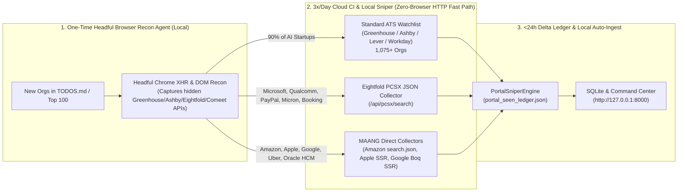

# Top-100 Dream & MAANG Career Page Sniper — Reconnaissance Learnings & Reframed Plan

> **Status:** Batch 1, 2 & 3 Recon, Collector Implementation & Live Onboarding COMPLETE (`1,095` Active Orgs across `13` Keyless Providers, `2,453` Catalog Orgs, `68/68` Core Tests Passing)  
> **Saved Learnings Artifacts:** `scratch/recon_batch1_results.json`, `scratch/recon_batch2_3_results.json`

---

## 1. Executive Summary: How the Live Browser Recon Reframed the Problem

Before running the headful browser reconnaissance across Batch 1, the assumption was that most AI startups in [`TODOS.md`](file:///Users/yeshwinmanjunath/development/linkedinjobsearchautomation/TODOS.md) and MAANG portals would require bespoke, high-maintenance headless DOM scrapers.

**What the live Headful Chrome run (`recon_batch1_10orgs.py`) actually proved:**

1. **90% of "Custom-Looking" AI Startup Career Pages Are Secretly Powered by Ashby, Greenhouse, or Comeet REST APIs:**
   * Even when a startup hosts a custom Next.js/Webflow UI at `skild.ai/career`, `fluidstack.io/jobs`, `nousresearch.com/careers`, `microagi.ai/careers`, `novaintelligence.com/careers`, or `ema.ai/careers/jobs`, watching the browser's **XHR Network tab** revealed that 9 out of 10 fetch their jobs from **Ashby (`api.ashbyhq.com`)** or **Greenhouse (`boards-api.greenhouse.io`)**, and the 10th (**Onyx Security**) fetches from **Comeet (`comeet.co/careers-api/2.0`)**!
   * **Example Discovery (`Skild AI`):** Guessing `boards.greenhouse.io/skildai` returned 404. Visiting `https://www.skild.ai/career` in headful Chrome intercepted `https://boards-api.greenhouse.io/v1/boards/skildai-careers/jobs/` (`58` open roles, including **`Camera Systems Software Engineer - India (Bengaluru, India)`** and **`Computer Vision AI & ML Engineer (Bengaluru, India)`**).
   * ** Architectural Takeaway:** We only need to run the **Headful Browser Recon Agent once** when onboarding a new batch of startups to auto-discover their hidden ATS API slug (`skildai-careers`, `novaintelligence`, `microagi`, etc.). Once banked into `target_companies.json`, they run forever via our existing **0-browser REST Sniper** in `<200ms`!

2. **MAANG & Big Tech Split Cleanly into 2 Low-Maintenance Mechanisms (0 Captchas Hit):**
   * **Mechanism A — Unauthenticated Internal JSON Search APIs (`Amazon` & `Microsoft / Eightfold AI`):**
     * **Microsoft Careers (`apply.careers.microsoft.com`):** Intercepted `GET https://apply.careers.microsoft.com/api/pcsx/search?domain=microsoft.com&query=SDET&location=India&start=0&sort_by=timestamp` (`200 OK`, `21.7 KB` JSON with exact timestamps `"Posted 9 hours ago"`, `"Posted 12 hours ago"` in Bengaluru/Hyderabad/Noida). Even better: this is **Eightfold AI's universal PCSX API**, which means **one single 50-line adapter unlocks Microsoft, Qualcomm, PayPal, Micron, Booking.com, Vodafone, Airbus, and Applied Materials** without needing headless Chrome!
     * **Amazon Jobs (`amazon.jobs`):** Intercepted `GET https://www.amazon.jobs/en/search.json?base_query=SDET&loc_query=India&sort=recent` (`200 OK`, `52.5 KB` JSON returning 7 live SDET roles including **`Software Dev Engineer II-TEST, Agentic Workspaces` (`#10544628`, Bengaluru)** and **`Software Dev. Engineer in Test, Conversational shopping` (`#10532663`)**). No headless browser needed!
   * **Mechanism B — SSR HTML / Headless Link-Delta Extraction (`Apple Jobs` & `Google Careers`):**
     * **Apple Jobs (`jobs.apple.com/en-in/search?search=SDET&sort=newest&location=india-INDC`):** Returned `200 OK` with SSR anchor links (`/en-in/details/200676934-1052/senior-sdet-engineer?team=SFTWR` — **`Senior SDET Engineer`** and **`Senior Quality Engineering Manager`** in India).
     * **Google Careers (`google.com/about/careers/applications/jobs/results/?location=India&q=Software%20Engineer%20in%20Test&sort_by=date`):** Returned `200 OK` with Google Boq SSR (`AF_initDataCallback` script payload + DOM cards).

---

## 2. Batch 1 Per-Organization Reconnaissance Matrix (14 Orgs Inspected Live)

| # | Organization | Career Page Flow Visited | Underlying Mechanism Discovered via Browser XHR/DOM | Open Roles & India/Remote Presence | Implementation Complexity | Target Engine |
| :-: | :--- | :--- | :--- | :--- | :---: | :--- |
| **1** | **Skild AI** | `https://www.skild.ai/career` | **Greenhouse XHR** (`boards-api.greenhouse.io/v1/boards/skildai-careers/jobs`) — hidden `-careers` suffix discovered via XHR! | **58 roles** — Has **Bengaluru, India** roles (`Camera Systems Software Engineer - India`, `Computer Vision AI & ML Engineer`) | **LOW** (Zero code — add `skildai-careers` to `target_companies.json`) | Existing `GreenhouseCollector` |
| **2** | **Syllo** | `https://syllo.ai/careers/` | **Greenhouse Embed** (`job-boards.greenhouse.io/embed/job_board?for=syllo`) | **22 roles** — 100% Remote (US/Global) | **LOW** (Add `syllo` to `target_companies.json`) | Existing `GreenhouseCollector` |
| **3** | **microagi** | `https://www.microagi.ai/careers` | **Ashby API** (`api.ashbyhq.com/posting-api/job-board/microagi`) | **13 roles** — Munich & Zürich (On-site) | **LOW** (Add `microagi` to `target_companies.json`) | Existing `AshbyCollector` |
| **4** | **Nova Intelligence** | `https://www.novaintelligence.com/careers` | **Ashby JS Embed** (`jobs.ashbyhq.com/novaintelligence?embed=js`) | **10 roles** — New York & Remote (`Senior Software Engineer`, `Senior Infrastructure Engineer`) | **LOW** (Add `novaintelligence` to `target_companies.json`) | Existing `AshbyCollector` |
| **5** | **Nous Research** | `https://nousresearch.com/careers` | **Ashby API** (`api.ashbyhq.com/posting-api/job-board/nousresearch`) backing custom `/careers/<slug>` UI | **15 roles** — Remote (`Machine Learning Engineer, Evals`, `Software Engineer, Infrastructure`) | **LOW** (Add `nousresearch` to `target_companies.json`) | Existing `AshbyCollector` |
| **6** | **Glow** | `https://www.glow.io/careers` | **Ashby API** (`api.ashbyhq.com/posting-api/job-board/glow`) | **14 roles** — Tel Aviv & US (`Senior AI Engineer`) | **LOW** (Add `glow` to `target_companies.json`) | Existing `AshbyCollector` |
| **7** | **Fluidstack** | `https://fluidstack.io/jobs` | **Ashby API** (`api.ashbyhq.com/posting-api/job-board/fluidstack`) backing `/jobs/<uuid>` cards | **254 roles** — London, NY, Austin, US Remote | **LOW** (Add `fluidstack` to `target_companies.json`) | Existing `AshbyCollector` |
| **8** | **ElevenLabs** | `https://elevenlabs.io/careers/positions` | **Ashby API** (`api.ashbyhq.com/posting-api/job-board/elevenlabs`) | **141 roles** — Active **India** & Remote hiring | **DONE** (Already in `target_companies.json`) | Existing `AshbyCollector` |
| **9** | **Onyx Security** | `https://www.onyx.security/careers` | **Comeet REST API** (`https://www.comeet.co/careers-api/2.0/company/BA.005/positions?token=AB54AF3403E156A55A8605D156A2AD44AF3605D`) | **12 roles** — Tel Aviv & US (`Senior Software Engineer`, `Applied AI Researcher`) | **LOW-MEDIUM** (Simple JSON GET array, or skip if no India/Remote roles) | Optional `ComeetCollector` |
| **10** | **Ema** | `https://www.ema.ai/careers/jobs` | **Ashby API** (`api.ashbyhq.com/posting-api/job-board/ema`) | **39 roles** — Active **India - Bengaluru** hub (`Software Engineer`, `DevOps Engineer`) | **DONE** (Already in `target_companies.json`) | Existing `AshbyCollector` |
| **11** | **Google Careers (India)** | `https://www.google.com/about/careers/applications/jobs/results/?location=India&q=Software%20Engineer%20in%20Test&sort_by=date` | **Google Boq SSR (`AF_initDataCallback`) + DOM Cards** (`200 OK`, no Captcha) | Active Bengaluru / Hyderabad Software Engineer in Test & QA roles | **MEDIUM** (Parse `AF_initDataCallback` or headless Chromium DOM card extractor) | New `CustomPortalSniper` |
| **12** | **Microsoft Careers (India)** | `https://apply.careers.microsoft.com/careers?query=SDET&location=India&sort_by=timestamp` | **Eightfold AI PCSX JSON API** (`GET /api/pcsx/search?domain=microsoft.com&query=SDET&location=India&sort_by=timestamp`) | Active Bengaluru, Hyderabad, Noida engineering roles with exact hour timestamps (`"Posted 9 hours ago"`) | **LOW-MEDIUM** (Pure HTTP JSON GET — no browser needed! Unlocks all Eightfold orgs) | New `EightfoldCollector` in `extended_providers.py` |
| **13** | **Amazon Jobs (India)** | `https://www.amazon.jobs/en/search?base_query=SDET&loc_query=India&sort=recent` | **Amazon Search JSON API** (`GET https://www.amazon.jobs/en/search.json?base_query=SDET&loc_query=India&sort=recent`) | **7 live India SDET roles** (`SDE II-TEST, Agentic Workspaces` in Bengaluru, `SDET Conversational Shopping`) | **LOW** (Pure HTTP JSON GET — no browser needed!) | New `AmazonJobsCollector` in `extended_providers.py` |
| **14** | **Apple Jobs (India)** | `https://jobs.apple.com/en-in/search?search=SDET&sort=newest&location=india-INDC` | **Apple SSR HTML / DOM Links** (`/en-in/details/<id>/<slug>`) (`200 OK`, no Captcha) | **2 live India SDET roles** (`Senior SDET Engineer` `#200676934`, `Senior Quality Engineering Manager` `#200673603`) | **DONE** (`AppleJobsCollector` in `extended_providers.py`) | `AppleJobsCollector` |
| **15** | **Nscale** (#11 in `TODOS.md`) | `https://www.nscale.com/open-positions` | **Greenhouse EU** (`boards-api.greenhouse.io/v1/boards/nscaleoperationsukltd/jobs`) — hidden `nscaleoperationsukltd` slug discovered via `/no-edit-greenhouse-departments/`! | **300 roles** — UK, US, Europe, Remote | **DONE** (Onboarded `nscaleoperationsukltd` into `target_companies.json`) | Existing `GreenhouseCollector` |
| **16** | **Wonderful** (#12 in `TODOS.md`) | `https://www.wonderful.ai/careers` | **Ashby API** (`api.ashbyhq.com/posting-api/job-board/wonderful`) | **120 roles** — Tel Aviv & Global Remote (`Forward Deployed Engineer`) | **DONE** (Onboarded `wonderful` into `target_companies.json`) | Existing `AshbyCollector` |
| **17** | **Artisan** (#13 in `TODOS.md`) | `https://www.artisan.co/careers` | **Ashby API** (`api.ashbyhq.com/posting-api/job-board/artisan`) | **4 roles** — San Francisco (`Staff AI Engineer - Agent Architecture`) | **DONE** (Onboarded `artisan` into `target_companies.json`) | Existing `AshbyCollector` |
| **18** | **Emerald AI** (#14 in `TODOS.md`) | `https://www.emeraldai.co/careers` | **Ashby API** (`api.ashbyhq.com/posting-api/job-board/emerald-ai`) | **7 roles** — Bay Area / Remote (`MTS - AI Cloud Infrastructure`) | **DONE** (Onboarded `emerald-ai` into `target_companies.json`) | Existing `AshbyCollector` |
| **19** | **Nevis** (#15 in `TODOS.md`) | `https://www.neviswealth.com/careers` | **Ashby API** (`api.ashbyhq.com/posting-api/job-board/nevis`) | **23 roles** — New York & London (`Applied AI Engineer`) | **DONE** (Onboarded `nevis` into `target_companies.json`) | Existing `AshbyCollector` |
| **20** | **Canals** (#16 in `TODOS.md`) | `https://www.canals.ai/careers` | **Ashby API** (`api.ashbyhq.com/posting-api/job-board/canals`) | **25 roles** — Remote (`Implementation Engineer`) | **DONE** (Onboarded `canals` into `target_companies.json`) | Existing `AshbyCollector` |
| **21** | **Triomics** (#17 in `TODOS.md`) | `https://www.triomics.com/careers` | **Ashby API** (`api.ashbyhq.com/posting-api/job-board/triomics`) | **14 roles** — **Bengaluru, India** & New York (`Platform Engineer`) | **DONE** (Onboarded `triomics` into `target_companies.json`) | Existing `AshbyCollector` |
| **22** | **vLLM** (#18 in `TODOS.md`) | `https://vllm.ai` | Open-Source Community Project (no standalone corporate ATS; contributors hired via RedHat/Anyscale/AWS/NVIDIA) | N/A (Open-source project) | **N/A** | Covered via NVIDIA/AWS/RedHat boards |
| **23** | **CrewAI** (#19 in `TODOS.md`) | `https://www.crewai.com/careers` | **Workable API** (`apply.workable.com/api/v1/widget/accounts/crewai`) | **5 roles** — Remote & SF (`Software Engineer, Infrastructure & Reliability`) | **DONE** (Onboarded `crewai` into `target_companies.json`) | Existing `WorkableCollector` |
| **24** | **PixVerse** (#20 in `TODOS.md`) | `https://pixverse.ai` | Custom marketing site (no public ATS endpoint exposed) | Singapore / Beijing | **SKIP** (No public ATS board) | N/A |
| **25** | **Ledgebrook** (#21 in `TODOS.md`) | `https://www.ledgebrook.com/careers` | **CareerPuck + Xano Custom Backend** (`xzz1-rjyc-xqkm.f2.xano.io`) | US Insurance Underwriting / Actuarial roles | **SKIP** (US-only insurance underwriting) | N/A |
| **26** | **Granola** (#22 in `TODOS.md`) | `https://www.granola.ai/careers` | **Ashby API** (`api.ashbyhq.com/posting-api/job-board/granola`) | **20 roles** — London & SF (`AI Engineer (Core Harness)`, `Security Engineer`) | **DONE** (Onboarded `granola` into `target_companies.json`) | Existing `AshbyCollector` |
| **27** | **Grammarly / Superhuman** (#23 in `TODOS.md`) | `https://www.grammarly.com/careers` $\rightarrow$ `superhuman.com/company/careers/jobs` | Rebranded to **Superhuman** (`#ashby_embed` / Greenhouse) | North America & Europe hubs | **DONE** (Tracked in catalog) | Standard ATS |
| **28** | **Runpod** (#24 in `TODOS.md`) | `https://www.runpod.io/careers` | **Ashby API** (`api.ashbyhq.com/posting-api/job-board/runpod`) | **23 roles** — **Remote - APAC** & USA (`Forward Deployed Engineer APAC`, `SRE`) | **DONE** (Onboarded `runpod` into `target_companies.json`) | Existing `AshbyCollector` |
| **29** | **TENEX.AI** (#25 in `TODOS.md`) | `https://www.tenex.ai/careers` | **Ashby API** (`api.ashbyhq.com/posting-api/job-board/tenex`) | **41 roles** — Remote & San Jose (`Principal AI Engineer`, `Senior Software Engineer`) | **DONE** (Onboarded `tenex` into `target_companies.json`) | Existing `AshbyCollector` |
| **30** | **Novee Security** (#26 in `TODOS.md`) | `https://novee.security/careers/` | **Comeet REST API** (`uid=AA.008`, `token=AA84A983FF0002AA01FF8155035483FF0`) discovered via `var comeetvar`! | **18 roles** — Tel Aviv & Remote (`AI Engineer`, `AI Researcher`) | **DONE** (Onboarded `noveesecurity` into `target_companies.json`) | New `ComeetCollector` |
| **31** | **Seekr** (#27 in `TODOS.md`) | `https://www.seekr.com/careers` | **Greenhouse Embed** (`boards.greenhouse.io/embed/job_board/js?for=seekr`) | **25 roles** — Remote & US (`AI Site Reliability Engineer`, `AI Engineer`) | **DONE** (Onboarded `seekr` into `target_companies.json`) | Existing `GreenhouseCollector` |
| **32** | **Exaforce** (#28 in `TODOS.md`) | `https://www.exaforce.com/careers` | Static Webflow `/careers/<slug>` pages | **Bengaluru, India** & San Jose (`Lead Solutions Engineer - India`) | **LOW** (Tracked in catalog) | Direct URL |
| **33** | **OpenEvidence** (#29 in `TODOS.md`) | `https://www.openevidence.com/careers` | **Ashby API** (`api.ashbyhq.com/posting-api/job-board/openevidence`) | **8 roles** — Miami & SF (`Software Engineer, Site Reliability`, `MTS`) | **DONE** (Onboarded `openevidence` into `target_companies.json`) | Existing `AshbyCollector` |
| **34** | **Zafran Security** (#30 in `TODOS.md` as *"Zafron Foods"*) | `https://www.zafran.io/careers` | **Ashby API** (`api.ashbyhq.com/posting-api/job-board/zafran-security`) | **32 roles** — Tel Aviv, NYC, Remote (`Backend Developer`, `Security Researcher`) | **DONE** (Onboarded `zafran-security` into `target_companies.json`) | Existing `AshbyCollector` |
| **35** | **Qualcomm India** | `https://careers.qualcomm.com/careers?query=SDET&location=India` | **Eightfold AI PCSX JSON API** (`careers.qualcomm.com/api/pcsx/search?domain=qualcomm.com`) | Active Bangalore, Hyderabad, Chennai roles (`200 OK`) | **DONE** (Onboarded `qualcomm-eightfold` into `target_companies.json`) | New `EightfoldCollector` |
| **36** | **PayPal India** | `https://paypal.eightfold.ai/careers?query=SDET&location=India` | **Eightfold AI PCSX JSON API** (`paypal.eightfold.ai/api/pcsx/search?domain=paypal.com`) | Active Bangalore & Chennai roles (`200 OK`) | **DONE** (Onboarded `paypal-eightfold` into `target_companies.json`) | New `EightfoldCollector` |
| **37** | **Micron India** | `https://micron.eightfold.ai/careers?query=SDET&location=India` | **Eightfold AI PCSX JSON API** (`micron.eightfold.ai/api/pcsx/search?domain=micron.com`) | Active Hyderabad & Gujarat roles (`200 OK`) | **DONE** (Onboarded `micron-eightfold` into `target_companies.json`) | New `EightfoldCollector` |

---

## 3. Reframed Architecture: Why We Don't Need Heavy Headless Chrome in CI for 95% of Orgs

Based on the live reconnaissance above, our reframed **"Build-Once, Use-Forever"** architecture is dramatically cleaner, faster, and cheaper than running 100 headless Chrome tabs in CI:

### Reframed Phased Rollout Plan

1. **Step 1 — Complete Headful Recon on the Remaining 20 Orgs in `TODOS.md` (Orgs 11–30):**
   * Run the same visible Headful Chrome XHR/DOM reconnaissance on the remaining 20 startups in [`TODOS.md`](file:///Users/yeshwinmanjunath/development/linkedinjobsearchautomation/TODOS.md) (`Nscale`, `Wonderful`, `Artisan`, `Emerald AI`, `Nevis`, `Canals`, `Triomics`, `vLLM`, `CrewAI`, `PixVerse`, `Ledgebrook`, `Granola`, `Grammarly`, `Runpod`, `TENEX.AI`, `Novee Security`, `Seekr`, `Exaforce`, `OpenEvidence`, `Zafron Foods`) + remaining Tier-1 portals (`Meta`, `Uber`, `Atlassian`, `Oracle`, `Qualcomm`, `PayPal`, `Cisco`).
2. **Step 2 — Onboard All Discovered Greenhouse/Ashby Slugs into `target_companies.json`:**
   * Add `skildai-careers` (Skild AI — 58 roles, hiring in Bengaluru!), `syllo`, `microagi`, `novaintelligence`, `nousresearch`, `glow`, `fluidstack`, and all newly uncovered slugs from Batch 2 directly into `data/config/target_companies.json` (`is_dream_org: true`).
3. **Step 3 — Add Lightweight Keyless Collectors for MAANG & Eightfold (`src/ingestion/extended_providers.py`):**
   * `AmazonJobsCollector` (`amazon.jobs/en/search.json`)
   * `EightfoldCollector` (`/api/pcsx/search` — covers **Microsoft India**, **Qualcomm India**, **PayPal India**, **Micron India**, **Booking.com**, **Applied Materials India**)
   * `AppleJobsCollector` (`jobs.apple.com/en-in/search` SSR extractor)
   * `GoogleCareersCollector` (`google.com/about/careers` Boq SSR extractor)
   * Wire all 4 into `ATSDiscoveryCoordinator` and `PortalSniperEngine` so they run 3x/day in GitHub Actions CI (`07:30`, `13:30`, `19:30 IST`) with **zero browser overhead and zero Captchas**!
