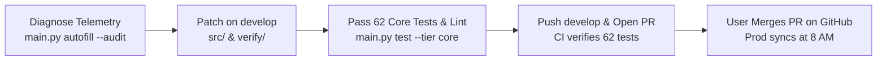

# Production Operations & Daily Workflow Guide

> **Quick Summary:** You never need to leave your primary workspace (`linkedinjobsearchautomation` on `develop`) to operate the system. Because of shared storage symlinks, all databases, staged jobs, telemetry logs, and browser cookies are accessible directly in your main workspace.

---

## 1. The 30-Second Mental Model: Dual-Branch Worktree Architecture

```text
/Users/yeshwinmanjunath/development/
├── linkedinjobsearchautomation/        <--- [YOUR MAIN WORKSPACE] (Branch: develop)
│   ├── .agents/                        <--- Streamlined Agent OS (3 Rules, 1 Skill, 3 Subagents)
│   ├── .browser_data/                  <--- Master LinkedIn & ATS session cookies
│   ├── data/                           <--- Master SQLite DB, queues, telemetry logs
│   └── (You review jobs, run /apply, fix bugs, and raise PRs here)
│
└── linkedinjobsearchautomation-prod/   <--- [ISOLATED DAEMON RUNNER] (Branch: main)
    ├── .browser_data  ───────(Symlink)───> Points to your develop .browser_data
    ├── data           ───────(Symlink)───> Points to your develop data
    └── (Runs silently at 8:00 AM IST via macOS launchd; pulls origin/main automatically)
```

---

## 2. Daily Operator Cheat Sheet

All commands below are run from your **primary workspace** (`linkedinjobsearchautomation`):

### Task 1: Check Morning Daemon & System Health
```bash
./venv/bin/python main.py daily diagnose
./venv/bin/python main.py daily audit
```
* Verifies `storage_state.json` authentication (`li_at` cookie), Gmail SMTP config, `launchd` registration, and recent run job counts across Track 1 (Direct ATS), Track 2 (LinkedIn + Sniper `<24h`), and Track 3 (Social Hiring Posts).

### Task 2: Open the 4-Tab Local Command Center (`http://localhost:8000`)
```bash
./venv/bin/python main.py dashboard
```
* **Tab 1 (`📋 Staging Review`):** Inspect fresh jobs with `⭐ Dream Org` badges and routing tiers (`TIER_0_POST_AUTHOR`, `TIER_1_SNIPER_APPLY`, `TIER_2_REFERRAL_SLA`). Compare Base vs. Tailored PDFs and click `✅ Approve` or `🤝 Generate Referral Note`.
* **Tab 2 (`🚀 Ready to Apply`):** View approved applications ready for high-speed execution.
* **Tab 3 (`📊 Applied Tracking`):** View your permanent SQLite ledger of `66+` submitted applications.
* **Tab 4 (`📢 Posts & Leads`):** Browse organic hiring posts from EMs, QA Leads, and recruiters with 1-click outreach notes ($\le 300$ chars), InMails ($\le 1000$ chars), and `mailto:` links.

### Task 3: Scout High-Responder Referrals for Dream Orgs
Instead of cold-applying to Workday / Dream Enterprise roles or messaging `10k+` follower influencers:
```bash
./venv/bin/python main.py referral-scout
```
* Attaches to Chrome on CDP Port `9222`, searches current employees at your approved Dream Orgs, rejects `"Ex-<Company>"` former employees and `>3,000` follower influencers, and ranks 1st-degree connections, post authors, and shared-alumni (`Dunzo`, `Value Labs`, `Tata Elxsi`, `SJCE`) peer SDETs.

### Task 4: Drain Approved Applications at High Speed (`/apply` & `form-batch`)
* **In Antigravity Chat:** Simply type **`/apply`**.
* **Under the Hood (2-Phase Batch Engine — 10–15+ Apps/Hr):**
  1. **Phase A (`<6s`):** `./venv/bin/python main.py form-batch inspect --job-id <id>` tags all controls with `data-agy-id`, fills 80–90% of fields (`60 Days` notice, `17 LPA` current / `27 LPA` expected CTC, `India (+91)` with `British Indian Ocean Territory (+246)` blocked), verifies via DOM read-back, and prints only `unmapped_fields`.
  2. **Phase B (1 Turn):** `./venv/bin/python main.py form-batch apply --job-id <id> --actions '<json>'` fills custom questions in one batch call and auto-banks them into `data/logs/learned_field_mappings.json` for zero-LLM reuse on future applications.
  3. **Submission Verification Gate (HTTP 412):** Verifies `SUBMISSION_CONFIRMED` log proof and screenshot in `data/logs/screenshots/` before marking `applied` in SQLite.

### Task 5: Audit Autofill Telemetry & Unmapped Questions Backlog
```bash
./venv/bin/python main.py autofill --audit
```
* Displays Phase A benchmark speeds (`autofill_benchmarks.jsonl`), vendor error rates, and top recurring custom questions (`unmapped_fields_backlog.jsonl`).

---

## 3. Diagnosing, Fixing & Deploying Changes (`develop -> PR -> main`)



1. **Run the Standardized Quality Gate:**
   ```bash
   ./venv/bin/python main.py test --tier core    # Must pass 62/62 (100%)
   ./venv/bin/python main.py lint                # Must show 0 errors
   ```
2. **Push to `develop` & Review PR on GitHub (Rule 9):**
   * AI agents never push or merge directly to `main`. All commits push to `origin/develop`, verified by GitHub Actions CI (`62/62` tests + Ruff lint), and you merge the PR on GitHub.
