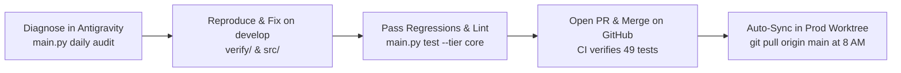

# Production Operations & Daily Workflow Guide

> **Quick Summary:** You never need to leave your primary workspace or open the `prod` directory to operate the system. Because of shared storage symlinks, all databases, staged jobs, and logs are accessible directly right here in your normal workspace.

---

## 1. The 30-Second Mental Model

Your automated job search operates using a **Dual-Branch Worktree Architecture**:

```
/Users/yeshwinmanjunath/development/
├── linkedinjobsearchautomation/        <--- [YOUR MAIN WORKSPACE] (Branch: develop)
│   ├── .browser_data/                  <--- Master LinkedIn session cookies
│   ├── data/                           <--- Master SQLite DB, queues, logs
│   └── (You code, fix bugs, and run commands here)
│
└── linkedinjobsearchautomation-prod/   <--- [ISOLATED DAEMON RUNNER] (Branch: main)
    ├── .browser_data  ───────(Symlink)───> Points to your develop .browser_data
    ├── data           ───────(Symlink)───> Points to your develop data
    └── (Runs silently at 8:00 AM IST via macOS launchd; you never need to cd here)
```

### Why this design?
1. **Zero Browser Locks:** Ephemeral headless Chrome runs at 8:00 AM using exported `storage_state.json` without conflicting with your open Chrome windows.
2. **Zero Git Disruptions:** Daily runs execute on `main` in the background without modifying your branch, dirtying your working tree, or interrupting your active coding sessions on `develop`.
3. **Shared Real-Time State:** Every job discovered, resume tailored, and log entry created by the background runner appears **immediately** inside your active development workspace.

---

## 2. Daily Operations Cheat Sheet

All commands below are run directly from your **primary workspace** (`linkedinjobsearchautomation`):

### Task 1: Check if the background daemon is healthy
Run the built-in system doctor:
```bash
python main.py daily diagnose
```
**What this inspects:**
* ✅ **LinkedIn Session:** Confirms `storage_state.json` exists and `li_at` authentication cookie is valid.
* ✅ **Zero-Cost Email:** Checks if optional Gmail SMTP credentials are configured in `.env`.
* ✅ **macOS Daemon:** Verifies that `com.linkedin.automator.daily` is registered with `launchctl`.
* ✅ **Latest Run:** Displays the timestamp, status, and duration of the most recent pipeline execution.

*(Quick Terminal alternative: `launchctl list | grep linkedin.automator`)*

---

### Task 2: Audit morning run telemetry & staged jobs
To see how many jobs were found and tailored during recent morning runs:
```bash
python main.py daily audit
```
**Example output:**
```text
  [2026-10-15T08:00:12] [RUN_COMPLETED] [SUCCESS] RunID: daily_20261015_a81f3c
     • Jobs Staged: 28 (5 Dream Orgs)
     • Regressions: PASS | Email: SENT | Duration: 42.1s
```
* **To see more past runs:** `python main.py daily audit --limit 10`

---

### Task 3: Manually test or trigger the morning run anytime
If you don't want to wait until 8:00 AM IST and want to run the full discovery pipeline right now:
```bash
bash scripts/run_daily_prod.sh
```
*(Or via python directly: `python main.py daily run --headless`)*

**What this does automatically:**
1. Pulls the latest production code (`git pull origin main`).
2. Runs the 49-test Tier 1 Core regression suite to ensure zero breakages.
3. Discovers fresh Senior SDET roles across Track 1 (Workday, Greenhouse, Lever, Ashby) and Track 2 (LinkedIn Stealth).
4. Tailors custom STAR resumes with anti-fabrication gates.
5. Sends your morning executive email briefing (or saves local archive to `data/logs/daily_report_YYYY-MM-DD.html`).
6. Ensures your Command Center dashboard is up and running on port 8000.

---

### Task 4: Launch & View the Local Command Center Dashboard
Start the web approval dashboard:
```bash
python main.py dashboard
```
Open your browser to: **[http://localhost:8000](http://localhost:8000)**

* **Tab 1 (`📋 Staging Review`):** Review pending jobs side-by-side with your tailored STAR resume.
  - Click `✅ Approve` to queue for application.
  - Click `🤝 Generate Referral Note` for Dream Orgs (auto-generates $\le 300$-char InMail pitches).
* **Tab 2 (`🚀 Ready to Apply`):** Your approved application cards.
  - Click `🚀 Launch Copilot` $\rightarrow$ Real Chrome opens, auto-fills the form, and **halts right before submit**.
  - Click `🖐️ Manual Apply` $\rightarrow$ Opens page with a floating candidate cheat-sheet helper.
* **Tab 3 (`📊 Applied Tracking`):** View your persistent SQLite ledger of submitted applications, direct job links, and archived PDFs.

---

### Task 5: Inspect the SQLite Database Directly
All application records, referral notes, and daily limits live in `data/app_database.db`:

```bash
# View recent applications:
sqlite3 data/app_database.db "SELECT id, company_name, job_title, status, applied_at FROM job_applications ORDER BY applied_at DESC LIMIT 5;"

# Check daily submission count:
sqlite3 data/app_database.db "SELECT date, count FROM daily_submission_limits ORDER BY date DESC LIMIT 3;"

# Check referral outreach notes:
sqlite3 data/app_database.db "SELECT company, requisition_id, status FROM referral_outreach LIMIT 5;"
```

---

## 3. How to Diagnose, Fix & Deploy Changes (`develop -> PR -> main`)

When an issue occurs (e.g. an ATS vendor changes a DOM selector, or a network timeout happens):



### Step 1: Diagnose the Failure
Run the diagnostic audit:
```bash
python main.py daily audit
```
Check the detailed operational logs:
* Operational text log: `data/logs/daily_runs.log`
* Structured event stream: `data/logs/daily_runs.jsonl`
* Background stdout / stderr: `data/logs/launchd_stdout.log` & `launchd_stderr.log`
* Headless failure screenshots: `data/logs/screenshots/` (open in Finder or view in Antigravity).

### Step 2: Reproduce & Patch on `develop`
1. Make your code edit in `src/`.
2. Run the specific verification script in `verify/` (e.g. `python verify/56_test_workday_autofill_heuristics.py`).

### Step 3: Run the Regression Gate & Linter
Before committing, ensure 100% pass rate:
```bash
python main.py test --tier core    # Must pass 50/50 (100%)
python main.py lint                # Must show 0 errors
```

### Step 4: Commit & Push to `develop`
```bash
git add .
git commit -m "fix(autofill): update vendor selector heuristic"
git push origin develop
```

### Step 5: Merge PR on GitHub
> 🔒 **Hard Constraint:** AI agents are strictly forbidden from committing or pushing directly to `main`. Every code change is pushed to `develop`, followed by opening a GitHub Pull Request via `gh pr create`.
1. The agent or developer opens a Pull Request from `develop` into `main` on GitHub.
2. **GitHub Actions CI** automatically runs the 50-test regression suite and Ruff linter.
3. The **USER** reviews the PR diff and clicks **Merge pull request** directly on GitHub.

### Step 6: Does the prod worktree get the changes automatically?
**YES!** You do not need to run anything.
Next morning at 8:00 AM IST, `scripts/run_daily_prod.sh` executes `git pull origin main` inside the prod worktree before running the daily search.
*(If you want to sync prod immediately after merging on GitHub, simply run `git -C ../linkedinjobsearchautomation-prod pull origin main`)*.

---

## 4. Emergency Troubleshooting FAQ

| Problem | Cause | One-Line Fix |
| :--- | :--- | :--- |
| **Status says "NOT AUTHENTICATED"** | LinkedIn cookies expired in `.browser_data/`. | Run `python main.py login`, log in once manually, then run `python main.py session export`. |
| **Email briefing not received in inbox** | `GMAIL_USER` / `GMAIL_APP_PASSWORD` not set in `.env`. | It safely saved the report locally! View `data/logs/daily_report_YYYY-MM-DD.html`. To enable email, add Gmail App Password to `.env`. |
| **Dashboard not opening on port 8000** | Port occupied or background service stopped. | Run `python main.py dashboard`. |
| **Daemon stopped running at 8 AM** | macOS LaunchAgent unloaded or laptop powered off. | Run `bash scripts/setup_daily_runner.sh` to re-register with `launchctl`. |
