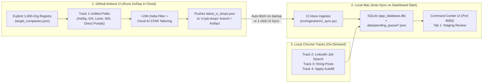

# Architecture Blueprint: Explicit 1,000-Org CI/CD Career Portal Sniper & Local Dashboard Ingestion

**Updated At:** `2026-11-01T23:01:00+05:30`  
**Scope:** Part 1 (Contact Discovery) dropped completely to avoid overbuilding. Focused 100% on the **Explicit 1,000-Org Daily CI/CD Research + Search Cycle & Local DB/Dashboard Integration**.

---

## Direct Answers to Core Architectural Questions

### Question 1: If we run the job on GitHub CI, how does it get onboarded into our local system? Will it show up in our local Command Center Dashboard (`localhost:8000`) and SQLite DB, or be separate?

**It will NOT be a separate dashboard—it flows straight into your existing local SQLite database (`data/app_database.db`) and `data/pending_queue/` so every job shows up in your local Command Center UI (`http://localhost:8000`) automatically.**

Because GitHub Actions runs on an ephemeral cloud runner while your SQLite DB (`data/app_database.db`) and `data/pending_queue/` live on your Mac (and are git-ignored so personal data isn't pushed publicly), here is the **cleanest, zero-friction bridge** between GitHub CI and your local dashboard:

#### The "Cloud Drop-Box $\rightarrow$ Local Auto-Ingest" Bridge (Zero Manual Copy-Paste)
1. **What GitHub Actions Does (Twice Daily Cron, e.g. `07:00 IST` & `19:00 IST`):**
   - Runs `python main.py portal-sniper --ci-mode`.
   - Scans your explicit registry of target organizations, filters for **QA/SDET + India/Remote + Posted `<24h`**, and writes a lightweight, structured delta file:
     - Either commits `data/ci_inbox/latest_ci_drops.json` + `data/ci_inbox/portal_seen_ledger.json` directly to a dedicated branch (`ci-job-drops` or `develop`), **OR** publishes a GitHub Actions Artifact (`daily-fresh-drops`) callable via `gh run download`.
   - *(Optional Bonus)*: If `GEMINI_API_KEY` is stored in your GitHub Repo Secrets, **GitHub CI can even run the AI STAR Resume Tailoring in the cloud**, so the payloads arrive 100% pre-tailored!
2. **How Your Local Dashboard (`localhost:8000`) Ingests It Automatically:**
   - We add an automatic **CI Inbox Sync Hook** right inside your FastAPI Dashboard startup (`src/ui/app.py`) and a `🔄 Sync CI Drops` button in the Command Center header (plus `python main.py sync-ci`):
   - Whenever you open `http://localhost:8000` (or run `python main.py dashboard`), the backend automatically:
     1. Fetches the latest `latest_ci_drops.json` (via `git fetch origin ci-job-drops` or `gh run download`).
     2. Deduplicates against your local `data/app_database.db` (`job_applications` & `tracked_requisitions`) and `data/processed_jobs.json`.
     3. Writes every new `<24h` role directly into `data/pending_queue/{job_id}.json` (tailoring any untailored ones) and logs the requisition into SQLite `tracked_requisitions`.
   - **Result:** You open `http://localhost:8000` in the morning, and all `<24h` jobs discovered by GitHub CI are **already sitting in your Tab 1 Staging Queue**, tagged with `🔥 SNIPER (<24h)` or `⭐ Dream Org`, ready for 1-click Approve & `/apply`.

---

### Question 2: Since Ashby, Greenhouse, Lever, and Workday are just API calls too, can we move ALL of Track 1 into this CI/CD flow and keep only Chrome-dependent LinkedIn scraping local?

**100% YES. That is a massive architectural upgrade.**

Look at how the pipeline in `src/pipeline/runner.py` currently works:
- Right now, when you run a search locally, your Mac has to do **everything sequentially**: poll Greenhouse, Lever, Ashby, Workday (Track 1), then launch Chrome for LinkedIn Jobs (Track 2), then launch Chrome for LinkedIn Hiring Posts (Track 3), then launch Chrome for Naukri.
- **By splitting Cloud API vs. Local Browser:**
  1. **Cloud CI/CD (`Track 1 — All Official Career Portals & ATS APIs`):**
     - Greenhouse, Lever, Ashby, Workday CXS, SmartRecruiters, Rippling, Workable, and Direct Company Career Portals have **zero dependency on your local Chrome session or LinkedIn login cookies**.
     - Moving Track 1 to GitHub Actions CI means **your 1,000 target companies are monitored 24/7 on autopilot**, even when your laptop is shut.
  2. **Local Mac (`Tracks 2 & 3 — Chrome Session Dependent`):**
     - Your local machine only needs to run **Chrome-authenticated workflows**:
       - Track 2: LinkedIn Job Board search (requires your residential IP + `.browser_data` session).
       - Track 3: LinkedIn Hiring Posts feed scouting.
       - `/apply`: Headful 2-Phase Batch Autofill & Referral outreach.
     - Your local runs become **3x faster** and never waste time polling 1,000 company career sites while you wait.

---

### Question 3: Sourcing Distinction — Are we explicitly polling 1,000 specific organizations, or just checking job providers?

> [!IMPORTANT]
> **We must be Organization-Centric (polling an explicit 1,000-company watchlist), NOT Provider-Centric.**
> - **Provider-Centric (Wrong Approach):** *"Let's only watch companies that happen to use Greenhouse or Ashby."* $\rightarrow$ If **Google, Apple, Amazon, Uber, Microsoft, Flipkart, Zepto, PhonePe, Swiggy, or Atlassian** use a custom career portal, Darwinbox, Oracle HCM, Eightfold, Phenom, or an internal GraphQL API, **they escape your sight completely.**
> - **Organization-Centric (Your Vision — The Right Approach):** **"We maintain an explicit Master Watchlist of 500–1,000 specific Target Organizations (`target_companies.json`). No company on our list is allowed to escape. The ATS/portal adapter is just the *mechanism* we attach to each company."**

#### How an "Explicit 1,000-Organization Watchlist" Works in Practice

Every single organization on your 1,000-company list is a first-class row in `data/config/target_companies.json` with an explicit **Coverage Status** and **Polling Adapter**:

| Adapter Tier | % of Top 1,000 Orgs | How We Poll That Specific Org | Examples |
| :--- | :--- | :--- | :--- |
| **Tier A: Standardized ATS JSON Adapter** | **~75% (750 Orgs)** | The company uses Greenhouse, Lever, Ashby, Workday CXS, SmartRecruiters, Rippling, Workable, or Recruitee under the hood (even if embedded on `careers.<company>.com`). We map their slug once during the **Research Cycle**, and poll their JSON API daily. | Stripe, Databricks, Rubrik, Postman, BrowserStack, Razorpay, Cred, Zscaler, Adobe, Nvidia, Salesforce, Target, Walmart, Visa, Linear, Vercel, Notion |
| **Tier B: Custom Enterprise Career API Adapter (Eightfold / Phenom / Oracle HCM / Custom XHR)** | **~20% (200 Orgs)** | Tech giants & Indian unicorns often use **Eightfold.ai** (`/api/apply/v2/jobs`), **Phenom People**, **Oracle Cloud HCM** (`/hcmRestApi/resources/latest/recruitingCEJobRequisitions`), or custom JSON endpoints (Google, Amazon, Apple, Microsoft, Meta, Uber, Flipkart). All of these return clean JSON to their career frontend without needing login cookies! | Apple, Amazon, Google, Microsoft, Uber, Booking.com, Qualcomm, PayPal, Oracle, Akamai, Cisco, JPMorgan |
| **Tier C: Headless Playwright / Sitemap Fallback Adapter** | **~5% (50 Orgs)** | For the remaining ~5% of companies whose career portal is a server-rendered HTML page or Darwinbox/Keka page with no clean JSON API, our CI job (which already has Playwright Chromium installed in `.github/workflows/ci.yml`!) loads their official career URL with keyword `SDET` / `QA` and extracts the job links & dates. | Niche Indian unicorns on Darwinbox/Keka or custom SSR career pages |

#### Why Separating the "Two Cycles" Makes 1,000 Explicit Orgs Possible:

1. **Cycle 1: The Research & Mapping Cycle (`python main.py org-research` — Run when adding new orgs or weekly health-check):**
   - You feed it your explicit list of 100 $\rightarrow$ 500 $\rightarrow$ 1,000 company names & domains (e.g., Top 200 Global Product Giants + Top 300 India GCCs in Bengaluru/Hyderabad/Pune + Top 300 Unicorns/Soonicorns + Top 200 Remote-First SaaS).
   - For each company, the **Research Probe** automatically inspects `careers.<domain>` / `<domain>/careers`, follows redirects/iframes, and fingerprints which adapter handles it (`greenhouse`, `workday`, `ashby`, `lever`, `smartrecruiters`, `oracle_hcm`, `eightfold`, or `playwright_dom`).
   - If a company ever migrates its career portal (e.g., moves from Lever to Ashby, causing a `404`), the daily scanner flags `BROKEN_ENDPOINT` in the report so the Research Probe re-maps that company—**ensuring zero companies ever silently drop off your radar.**

2. **Cycle 2: The Daily `<24h` Search & Onboarding Cycle (Runs Daily in GitHub Actions CI):**
   - Iterates through **every active organization** in `target_companies.json`.
   - Checks for matching `SDET / QA / Automation` roles in `India / Remote` posted within the **last 24 hours** (cross-referenced against `portal_seen_ledger.json`).
   - Produces the Daily Matching Report and pushes the `<24h` drops to your `ci-job-drops` inbox so your local Command Center (`localhost:8000`) ingests them into SQLite and `data/pending_queue/`.

---

## Summary of End-to-End Execution Split

| Workflow | Where It Runs | Frequency | What It Does |
| :--- | :--- | :--- | :--- |
| **1. Org Research & Endpoint Health (`Cycle 1`)** | CLI / CI Utility (`org-research`) | Whenever adding orgs / Weekly | Maps & verifies the exact career portal endpoint for all 100–1,000 explicit target companies so no org is ever missed or silently broken. |
| **2. Official Portal `<24h` Sniper (`Cycle 2 / Track 1`)** | **GitHub Actions Cron** (Headless Cloud) | Every 12h / 24h (`07:00 IST` & `19:00 IST`) | Polls all 100–1,000 explicit orgs (Ashby, GH, Lever, Workday, SmartRecruiters, Oracle HCM, Eightfold, etc.), filters for `<24h` QA/SDET drops, tailors resumes, and writes `data/ci_inbox/latest_ci_drops.json`. |
| **3. Local DB & Dashboard Onboarding** | **Local Mac** (`localhost:8000` startup / `sync-ci`) | Automatic on Dashboard open | Pulls `latest_ci_drops.json`, deduplicates against `app_database.db`, and stages all new `<24h` jobs directly into `data/pending_queue/` for Tab 1 UI review. |
| **4. Chrome-Authenticated Scraping (`Tracks 2 & 3`)** | **Local Mac** (Persistent Chrome CDP) | On-demand (`main.py search` / `posts`) | Only scrapes what *requires* your logged-in Chrome browser (LinkedIn Job Board & LinkedIn Hiring Posts feed). |
| **5. Application Execution (`/apply`)** | **Local Mac** (Headful Chrome CDP) | After 1-click UI Approval | Runs the 2-Phase Batch Autofill engine (`UniversalBatchFormFiller`) on approved jobs. |

---

## Next-Session Implementation Phases (When Argon Quota Resets)

1. **Phase 1 — Expand Explicit Watchlist & Multi-Tier Adapters (`target_companies.json` + `org-research` Probe):**
   - Add `SmartRecruitersCollector`, `RipplingCollector`, `EightfoldCollector`, and `OracleHCMCollector` alongside existing `Greenhouse`, `Lever`, `Ashby`, and `Workday` collectors.
   - Build `python main.py org-research` to auto-fingerprint and verify official career endpoints across the explicit 100 $\rightarrow$ 1,000 target organization directory, flagging any `BROKEN_ENDPOINT` so zero organizations ever escape monitoring.
2. **Phase 2 — Strict `<24h` Freshness Delta Scanner & CI Mode (`portal-sniper --ci-mode`):**
   - Implement `portal_seen_ledger.json` + `<24h` publish-date cross-referencing and Daily Matching Report generation (`data/ci_inbox/latest_ci_drops.json` & `.md`).
   - Add `.github/workflows/daily_portal_sniper.yml` scheduled cron job to run Track 1 completely in GitHub Actions.
3. **Phase 3 — Local SQLite & Command Center Auto-Ingest (`src/ingestion/ci_sync.py`):**
   - Wire automatic CI drop ingestion into `src/ui/app.py` startup and `python main.py sync-ci` so all cloud-discovered `<24h` jobs populate `data/app_database.db` and `data/pending_queue/` on `http://localhost:8000`.
   - Default local `python main.py search` to Chrome-only tracks (`linkedin` + `posts`) since Track 1 is handled by the CI sniper.
