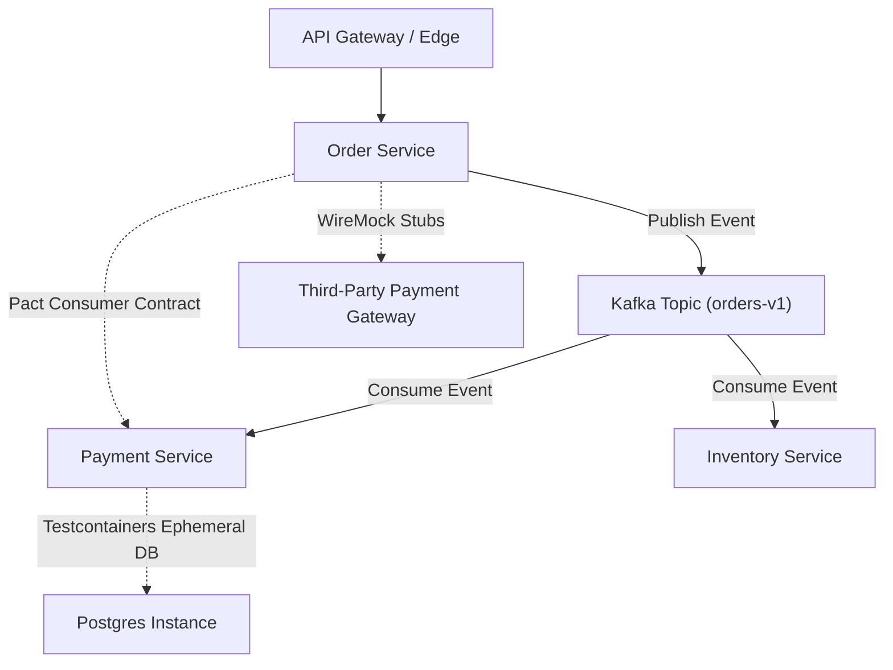

# Senior SDET System Design for Testability & Distributed Test Architecture

**Role Level:** Senior SDET / Lead Quality Architect (~6.8 YOE, ₹25–35+ LPA / $50k–$65k USD Band)  
**Core Domain:** Distributed Systems, Asynchronous Event Streaming, Microservice Contract Testing, CI Pipeline Sharding  

---

## 1. Architectural Philosophy: The Shift from E2E Monoliths to Testability

In modern microservice architectures, traditional black-box end-to-end (E2E) testing fails due to:
- High deployment latency & environment contention.
- Network flakiness and uncoordinated downstream service state.
- Inability to simulate catastrophic distributed failure modes (e.g. partition splits, out-of-order Kafka events).

**System Design for Testability (SDfT)** treats testability as a first-class architectural requirement:



---

## 2. Blueprint 1: Consumer-Driven Contract Testing with Pact

### The Problem
Microservices deployed independently frequently break integrations when upstream APIs alter payloads, change optionality, or deprecate endpoints. Maintaining a static shared staging environment creates severe deployment bottlenecks.

### Architectural Solution
Use **Consumer-Driven Contract Testing (CDCT)** via Pact:
1. **Consumer Phase (e.g., Order Service):**
   - The consumer writes unit-level integration tests against a local Pact mock server.
   - The interactions are serialized into a JSON **Pact contract file** specifying exact request headers, bodies, response status, and structural matchers (e.g., `like()`, `term()`, `eachLike()`).
   - The contract is published to the **Pact Broker** during the consumer's CI build.
2. **Provider Phase (e.g., Payment Service):**
   - The provider CI pipeline pulls the contract from the Pact Broker.
   - Pact replays the consumer's recorded requests against the real provider endpoint (with dependencies stubbed) and validates the contract.
   - The provider runs `can-i-deploy` against the Pact Broker before promoting to production.

```typescript
// Sample Pact TypeScript Consumer Interaction Definition
import { PactV3, MatchersV3 } from '@pact-foundation/pact';

const provider = new PactV3({
  consumer: 'OrderService',
  provider: 'PaymentService',
});

describe('Payment API Contract', () => {
  it('processes payment authorization successfully', async () => {
    provider.addInteraction({
      states: [{ description: 'account has sufficient balance' }],
      uponReceiving: 'a request to authorize payment',
      withRequest: {
        method: 'POST',
        path: '/v1/payments/authorize',
        headers: { 'Content-Type': 'application/json' },
        body: {
          orderId: MatchersV3.regex('^ord-[0-9a-f]{8}$', 'ord-1234abcd'),
          amountCents: MatchersV3.like(4999),
          currency: 'USD',
        },
      },
      willRespondWith: {
        status: 200,
        headers: { 'Content-Type': 'application/json' },
        body: {
          authorizationId: MatchersV3.uuid(),
          status: MatchersV3.term({
            matcher: 'AUTHORIZED|PENDING',
            generate: 'AUTHORIZED',
          }),
        },
      },
    });

    await provider.executeTest(async (mockServer) => {
      const client = new PaymentClient(mockServer.url);
      const res = await client.authorize('ord-1234abcd', 4999, 'USD');
      expect(res.status).toBe('AUTHORIZED');
    });
  });
});
```

---

## 3. Blueprint 2: Asynchronous Event-Stream Validation with Apache Kafka

### The Problem
Testing event-driven systems requires validating asynchronous side effects, ordering guarantees, schema evolution, and Dead Letter Queue (DLQ) fault tolerance without creating persistent cross-test state pollution.

### Architectural Solution
1. **Dynamic Ephemeral Consumer Groups:**
   - Every automated test run generates a unique UUID-based Consumer Group ID (`test-runner-${UUID}`), preventing offset collisions and message stealing across parallel workers.
2. **Schema Registry Enforcement:**
   - Test payloads must validate against Confluent Schema Registry (Avro or Protobuf) before publishing.
3. **Deterministic Polling & Idempotency Testing:**
   - Avoid `Thread.sleep()`. Implement condition-based polling with configurable timeout and backoff.
   - Fire duplicate event messages and assert that downstream state remains idempotent.
4. **Dead Letter Queue (DLQ) Verification:**
   - Inject malformed messages or trigger consumer-side exceptions; assert that the poisoned message is routed to `${topic}.DLQ` within SLA without halting partition processing.

```python
# Deterministic Kafka Event Consumer Assertion Engine
import json
import time
from confluent_kafka import Consumer, KafkaError


class KafkaEventVerifier:
    def __init__(self, bootstrap_servers: str, topic: str, test_id: str):
        self.topic = topic
        self.consumer = Consumer(
            {
                "bootstrap.servers": bootstrap_servers,
                "group.id": f"sdet-verifier-{test_id}",
                "auto.offset.reset": "latest",
                "enable.auto.commit": False,
            }
        )
        self.consumer.subscribe([topic])

    def poll_for_event(self, predicate, timeout_sec: float = 10.0) -> dict | None:
        """Polls topic until a message matching predicate is found or timeout occurs."""
        deadline = time.time() + timeout_sec
        while time.time() < deadline:
            msg = self.consumer.poll(timeout=0.5)
            if msg is None:
                continue
            if msg.error():
                if msg.error().code() == KafkaError._PARTITION_EOF:
                    continue
                raise RuntimeError(f"Kafka consumer error: {msg.error()}")

            payload = json.loads(msg.value().decode("utf-8"))
            if predicate(payload):
                return payload
        return None

    def close(self):
        self.consumer.close()
```

---

## 4. Blueprint 3: Distributed Test Execution Sharding with Docker & Kubernetes

### The Problem
Large end-to-end automation test suites run sequentially for 45–60 minutes, stalling pull request merges and breaking CI feedback loops.

### Architectural Solution
Dynamic Sharding & Containerized Runner Pools:
1. **Test Discovery & Metadata Extraction:**
   - Prior to execution, parse all test suites and collect historical execution duration from test results storage (e.g., Datadog / SQLite / S3 metadata).
2. **Dynamic Bin-Packing Algorithm:**
   - Rather than dividing tests simply by file count (which causes straggler workers), use a **Longest Processing Time (LPT) first greedy bin-packing algorithm** to distribute tests across $N$ parallel container runners such that all shards finish at approximately the same time.
3. **Ephemeral Testcontainers:**
   - Spin up isolated PostgreSQL and WireMock containers inside each test pod, ensuring 100% database state isolation with zero shared test data conflicts.
4. **Impact:** Reduces test execution from **45 minutes to 6 minutes** across 8 parallel worker pods.

---

## 5. Blueprint 4: Synthetic Data & Contract Mocking with WireMock

- **Decoupled 3rd Party APIs:** Replace live payment gateways (Stripe, Adyen) or SMS providers (Twilio) with Dockerized WireMock stubs.
- **Fault Injection:** Simulate edge network topologies:
  - 504 Gateway Timeouts
  - HTTP 429 Rate Limiting with `Retry-After: 3` header
  - Slow network delays (artificial 5,000ms latency) to assert client-side circuit breakers.
