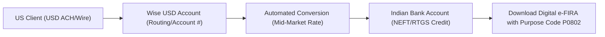

# Foreign Inward Remittance Advice (FIRA) & Wise Remittance Checklist

**Target Audience:** Senior SDET / Remote Software Contractor (~6.8 YOE)  
**Corridor:** Inward USD Remittance ($50k–$65k USD Annual Band)  
**Regulatory Framework:** Reserve Bank of India (RBI) Foreign Exchange Management Act (FEMA) & Section 2(6) IGST Act  
**Primary Receiving Channel:** Wise / SWIFT Authorized Dealer (AD) Banking Corridors  

---

## 1. Statutory Role of FIRA / FIRC

A **Foreign Inward Remittance Advice (FIRA)** or **Foreign Inward Remittance Certificate (FIRC)** is an official document issued by an Authorized Dealer (AD Category-I) bank in India confirming:
1. An incoming transfer of foreign currency originated outside India.
2. The funds were converted into Indian Rupees (INR) at an authorized exchange rate.
3. The transaction complied with RBI guidelines under a specified **RBI Purpose Code**.

### 1.1 Why FIRA is Legally Essential
- **GST Export Substantiation:** Proves condition 4 of **Section 2(6) of the IGST Act** (*"payment received in convertible foreign exchange"*). Without a FIRA, GST authorities can treat your earnings as domestic un-invoiced revenue and demand 18% GST plus interest.
- **Income Tax Protection:** Defends against Section 68 / 69 scrutiny notices by verifying that high-value bank credits represent legitimate professional export receipts under Section 44ADA.

---

## 2. RBI Purpose Codes for Software Engineering & SDET

Whenever configuring your payment gateway, Wise profile, or answering bank remittance declarations, **you must specify the exact RBI Purpose Code**.

| Purpose Code | Official Description | Applicability |
|---|---|---|
| **P0802** | **Software implementation services / IT design & software development** | **Primary Recommended Code:** Covers SDET framework architecture, Playwright/TypeScript test pipelines, and distributed QA services. |
| **P0803** | Data processing, hosting, and platform infrastructure | Secondary: Cloud test infrastructure & CI runner management. |
| **P0807** | Off-site software maintenance & technical support | Secondary: Ongoing test automation maintenance contracts. |

> ⚠️ **CRITICAL WARNING:** Never select **P1007** (*Gifts / Family Maintenance*) or general miscellaneous codes. Selecting a personal or non-commercial purpose code immediately invalidates your GST 0% export zero-rating and disqualifies Section 44ADA eligibility.

---

## 3. Remittance Corridor Comparison: Direct SWIFT vs. Wise

| Feature | Direct SWIFT to Indian Bank | Wise (Virtual US Account) |
|---|---|---|
| **Payer Experience** | US client initiates international wire ($25–$45 fee). | US client initiates local ACH / domestic wire ($0–$1 fee). |
| **Forex Markup** | 1.5% to 3.0% hidden bank spread over mid-market. | **Zero hidden markup** (Exact mid-market Google rate). |
| **Transfer Fees** | $15–$30 intermediary correspondent fees deducted. | Flat nominal fee (~0.35% – 0.45%). |
| **Speed** | 2 to 5 business days. | **Instant to 24 hours**. |
| **FIRA Generation** | Manual application to bank AD branch (often ₹200–₹500 fee). | **Automated digital e-FIRA download** from Wise portal for free. |

---

## 4. Step-by-Step Wise & Bank Setup Workflow



### Step 1: Open Wise Account & Obtain US Virtual Details
1. Register on Wise and complete KYC using your Indian Passport and PAN.
2. Open a **USD Currency Balance**: Wise provisions an individual US checking routing number, account number, and bank address (e.g., Evolve Bank & Trust / Community Federal Savings Bank).
3. Provide these domestic US banking details on your client's onboarding portal (Deel, Rippling, Gusto, or Direct Contractor Agreement).

### Step 2: Configure Inward Purpose Code
1. In Wise Settings $\rightarrow$ Remittance Preferences $\rightarrow$ Select India Bank Account.
2. Set Default Purpose Code to: **`P0802 - Software implementation services`**.

### Step 3: Automated Inward Transfer & e-FIRA Retrieval
1. Once the client initiates payment, funds arrive in your US virtual account and are automatically remitted to your linked Indian savings/current bank account via RBI-approved partner banks.
2. Within 2 to 3 days of credit, navigate to **Wise Activity** $\rightarrow$ Click on the transaction $\rightarrow$ Click **"Download FIRA"**.
3. Verify that the generated e-FIRA document contains:
   - Unique Transaction Reference (UTR)
   - Foreign Remitter Name (Client entity)
   - Foreign Currency Amount ($ USD)
   - Conversion Rate Applied
   - Purpose Code **P0802**
   - Authorized Dealer Bank Seal / Digital Signature

---

## 5. Monthly Accounting & Audit Trail Archive

Maintain a structured folder hierarchy for every financial year:

```
compliance_vault/
└── FY_2026_2027/
    ├── April_2026/
    │   ├── Invoice_001_USD.pdf          (Citing LUT ARN, SAC 998314)
    │   ├── Wise_Transfer_Receipt.pdf    (Transfer breakdown)
    │   ├── Bank_Credit_Advice_UTR.pdf   (Indian bank statement entry)
    │   └── e_FIRA_P0802.pdf             (Statutory RBI proof)
    └── May_2026/
        └── ...
```
